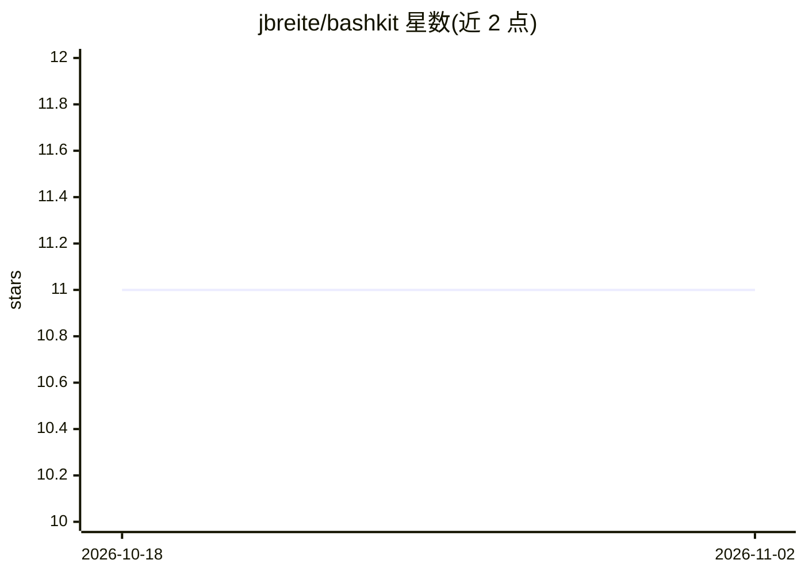

# jbreite/bashkit

⭐ 11 · TypeScript · MIT · 推送 2026-06-16 · [GitHub](https://github.com/jbreite/bashkit) · [官网](https://bashkit-docs.vercel.app) · 个人维护

**给 Vercel AI SDK 提供沙箱化编码工具集的 agent 开发库**

面向 Vercel AI SDK 的 agentic coding 工具库：提供 Bash 执行、文件读写编辑、Glob/Grep 搜索、子 agent（Task/TodoWrite）、WebSearch/WebFetch、按需加载 Agent Skills 等工具，在三种沙箱（本地文件系统的 LocalSandbox、Vercel Firecracker microVM 的 VercelSandbox、E2B 云沙箱）中运行。附带上下文管理层：系统提示组装（识别 AGENTS.md/CLAUDE.md）、对话压缩、上下文状态监控、工具结果缓存（LRU/自定义 CacheStore）与 Anthropic 提示缓存中间件。通过 npm 安装，支持按工具配置超时、路径白名单与命令黑名单等安全限制。

## 筛选速览

| 维度 | 判定 | 备注 |
|---|---|---|
| AI 角色 | `ai-ecosystem` | LLM/agent 周边工具 |
| 许可风险 | `permissive` | MIT |
| 部署形态 | `None` |  |
| 模型依赖 | locked-api |  |
| 硬件要求 | — | 无带数字的原话,不猜 |
| 安装摩擦 | `low` | 无编译、无系统依赖或容器化 |
| 成熟度 | — | 结构信号不足 |

## 能力要点

- Bash/Read/Write/Edit/Glob/Grep 等默认工具与 AskUser、PlanMode、Codemode、Skill 等可选工具
- 三种沙箱后端：LocalSandbox、VercelSandbox（Firecracker microVM）、E2BSandbox
- 子 agent 编排：Task 工具支持预定义与动态 agent，可流式输出子 agent 活动到 UI
- 上下文管理：对话压缩、上下文状态监控、工具结果缓存（可自定义 Redis 后端）
- 内置模型上下文限制表与 Anthropic 提示缓存中间件

## 适用场景

- 在 Vercel AI SDK 应用中给 agent 增加文件读写与命令执行能力
- serverless 环境下用 Vercel/E2B 沙箱运行不受信任的 agent 代码
- 为长对话 agent 实现上下文压缩与工具结果缓存
- 用 allowedPaths/blockedCommands 等配置约束 agent 的文件与命令操作范围

## 场景标签

`Agent 框架` · 领域:Agent 开发

## 证据(README 行号)

> L5: Agentic coding tools for Vercel AI SDK. Give AI agents the ability to execute code, read/write files, and perform co
> L9: `bashkit` provides a set of tools that work with the Vercel AI SDK to enable agentic coding capabilities. It gives A

## 星数曲线

2026-10-18 11 → 2026-11-02 11（+0）

---
*卡片 v1 · prompt 1.4 · 生成 2026-11-02 · 置信度 high · 依据 README sha `9ce1579f5b69` · [字段定义](../../DATASET.md)*
