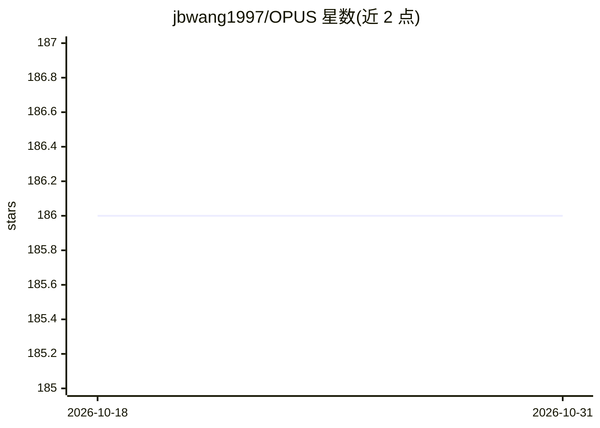

# jbwang1997/OPUS

⭐ 186 · Python · MIT · 推送 2026-05-03 · [GitHub](https://github.com/jbwang1997/OPUS) · 组织维护 · 中文 README

**自动驾驶 3D 占用预测框架：稀疏点集直接预测占用状态与语义**

NeurIPS 2024 论文 OPUS 及其后续 OPUS-V2 的官方实现，面向自动驾驶感知研究者。以 transformer 编码器-解码器加可学习查询集的方式，将体素化 3D 环境的占用预测建模为集合预测，用 Chamfer/DCD 损失做集合间比较，V2 增加 CPD 模块将连续预测映射到离散体素空间并支持任意分辨率。基于 PyTorch 1.13.1 + CUDA 11.6 与 mmcv/mmdet 生态，需编译 CUDA 扩展，提供 nuScenes/Occ3D/OpenOccupancy 上的训练、评测与可视化脚本及预训练模型库。

## 筛选速览

| 维度 | 判定 | 备注 |
|---|---|---|
| AI 角色 | `ai-native` | 本体是模型或模型工具 |
| 许可风险 | `permissive` | MIT |
| 部署形态 | `library` | 以包/库形式分发 |
| 模型依赖 | — | README 未给出锁定关系 |
| 硬件要求 | — | 无带数字的原话,不猜 |
| 安装摩擦 | `high` | 编译与系统依赖俱全 |
| 成熟度 | — | 结构信号不足 |

## 能力要点

- 稀疏查询集合同时预测占用位置与语义类别，无需显式稠密体素建模
- OPUS-V2 增加 CPD 模块，支持任意分辨率，Occ3D 上 RayIoU 44.0
- 提供 T/S/M/L 多尺寸模型与相机、相机-LiDAR 融合版本及预训练权重
- 包含数据预处理、单/多 GPU 训练、评测与可视化完整流程

## 适用场景

- 在 nuScenes/Occ3D 数据集上训练和评测占用预测模型
- 复现或对比 OPUS/OPUS-V2 的占用预测结果
- 做自动驾驶感知相关研究并引用官方代码

## 场景标签

`目标检测` · 领域:感知与多模态

## 证据(README 行号)

> L36: Occupancy prediction, aiming at predicting the occupancy status within voxelized 3D environment, is quickly gaining
> L39: Our proposed framework, called OPUS, utilizes a transformer encoder-decoder architecture to simultaneously predict 

## 星数曲线

2026-10-18 186 → 2026-10-31 186（+0）

---
*卡片 v1 · prompt 1.4 · 生成 2026-10-22 · 置信度 mid · 依据 README sha `23830d88fce4` · [字段定义](../../DATASET.md)*
