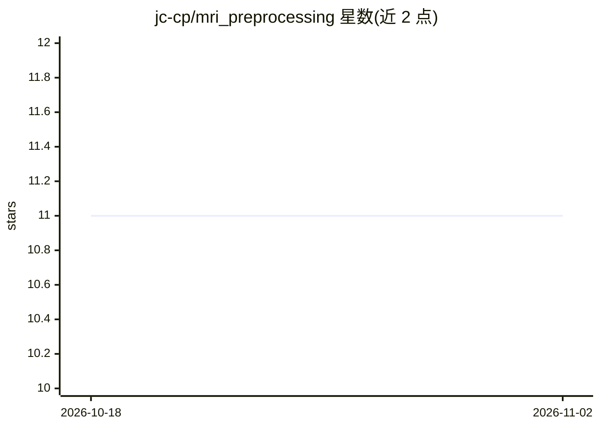

# jc-cp/mri_preprocessing

⭐ 11 · Python · MIT · 推送 2025-12-19 · [GitHub](https://github.com/jc-cp/mri_preprocessing) · 个人维护

**给科研/工程用户的 MRI 图像可配置预处理流水线**

基于单一 JSON 配置文件驱动的 MRI 图像预处理流水线：读取 DICOM/NIfTI 等格式，按配置中的标志执行预处理步骤（N4 偏置场校正、去噪、运动校正、配准、重采样、归一化、质量控制等）并保存结果、记录日志。面向研究人员与工程师，便于实验不同的预处理步骤组合。README 按 sMRI/fMRI/DTI/ASL/MRS/SWI 等成像类型说明相应处理步骤，并提供配置模板。运行方式为 python3 main.py -cfg 指定配置文件。

## 筛选速览

| 维度 | 判定 | 备注 |
|---|---|---|
| AI 角色 | `ai-native` | 本体是模型或模型工具 |
| 许可风险 | `permissive` | MIT |
| 部署形态 | `None` |  |
| 模型依赖 | — | README 未给出锁定关系 |
| 硬件要求 | — | 无带数字的原话,不猜 |
| 安装摩擦 | `low` | 无编译、无系统依赖或容器化 |
| 成熟度 | — | 结构信号不足 |

## 能力要点

- 单一 JSON 配置文件驱动整个预处理流程
- 支持 DICOM/NIfTI 等格式读取并转换为统一工作格式
- 覆盖 N4 偏置场校正、多种去噪、运动校正、配准、重采样、归一化、质量控制等步骤
- 按 sMRI/fMRI/DTI/ASL/MRS/SWI 成像类型提供配置模板说明

## 适用场景

- 我需要为不同 MRI 成像类型搭建可复用的预处理流程
- 我想实验不同的去噪/归一化方法找出适合自己数据的组合
- 我要把 DICOM 数据转换并配准到标准空间（如 MNI）

## 场景标签

`科研工具` `图像视频处理` · 领域:学习与行业

## 证据(README 行号)

> L14: This repository aims to present a general, customizable pipeline for MRI images based on a single configuration fil
> L33: The main.py script only needs one single configuration file, passed as an argument when running the script.

## 星数曲线

2026-10-18 11 → 2026-11-02 11（+0）

---
*卡片 v1 · prompt 1.4 · 生成 2026-11-02 · 置信度 mid · 依据 README sha `c3c024059284` · [字段定义](../../DATASET.md)*
