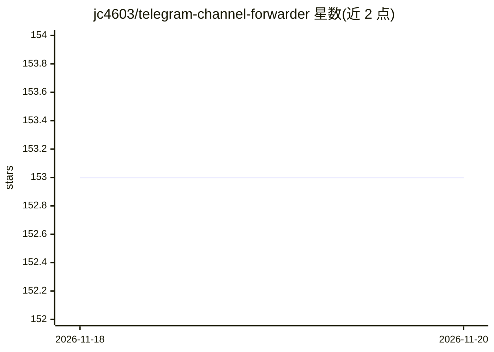

# jc4603/telegram-channel-forwarder

⭐ 153 · HTML · 推送 2026-11-19 · [GitHub](https://github.com/jc4603/telegram-channel-forwarder) · 个人维护

**Windows 本地运行的 Telegram 频道自动转发与 AI 改写工具**

面向 Telegram 频道管理员与内容策展人的 Windows 桌面工具：通过 Telegram 用户客户端直接监听公开、私有与受限频道，新帖出现即捕获并可零延迟转发；转发前可经语言模型改写（自定义提示模板、摘要、多语言翻译、创意度调节），并剥离竞品提及、外部链接、话题标签与推广尾注。支持多源多目标路由、Telegram 内联审批流（批准/编辑/拒绝）、配置档案导出导入与实时日志。全部凭据与配置本地存储，仅需 Telegram API ID/Hash，以斜杠命令驱动。

## 筛选速览

| 维度 | 判定 | 备注 |
|---|---|---|
| AI 角色 | `ai-enhanced` | 去掉 AI 部分产品仍成立 |
| 许可风险 | `none` | — |
| 部署形态 | `None` |  |
| 模型依赖 | — | README 未给出锁定关系 |
| 硬件要求 | — | 无带数字的原话,不猜 |
| 安装摩擦 | `low` | 无编译、无系统依赖或容器化 |
| 成熟度 | — | 结构信号不足 |

## 能力要点

- 零延迟捕获并转发公开/私有/受限频道新帖
- 基于自定义提示模板的自动改写、摘要与多语言翻译
- 链接/提及/标签/水印清理规则可独立开关
- Telegram 内联审批流与配置档案导出导入

## 适用场景

- 把多个源频道的帖子改写后自动同步到自己的频道
- 翻译并统一频道内容语气后发布
- 转发前清除竞品提及与推广链接并人工审批

## 场景标签

`AI 写作` · 领域:内容生成

## 证据(README 行号)

> L7: Telegram Channel Forwarder is a community-driven desktop tool built for channel admins and content curators who want
> L139: Telegram Channel Forwarder is an automated Windows desktop tool that watches your source Telegram channels, captur
> L145: The forwarder integrates with an language model to rewrite incoming posts. You control the behavior with a custom 

## 星数曲线

2026-11-18 153 → 2026-11-20 153（+0）

---
*卡片 v1 · prompt 1.4 · 生成 2026-11-18 · 置信度 mid · 依据 README sha `b4a1f2ac85ee` · [字段定义](../../DATASET.md)*
