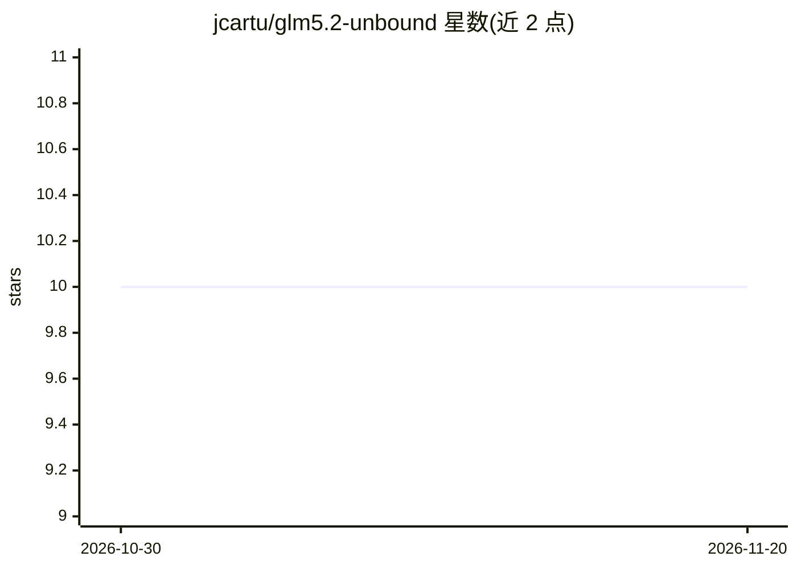

# jcartu/glm5.2-unbound

⭐ 10 · Python · MIT · 推送 2026-07-23 · [GitHub](https://github.com/jcartu/glm5.2-unbound) · 个人维护

**在 4 张 GPU 上本地部署无审查 GLM-5.2 的方案与复现指南**

记录在 4 张 96 GB Blackwell 级 GPU 上以 TP4/DCP4 部署约 750B GLM-5.2 混合量化检查点的完整方案：核心发现是模型已被 abliteration 处理，拒绝行为源于默认开启的思考路径，通过 `enable_thinking:false` 加宽松系统提示即可绕过。仓库提供 docker-compose 部署配置、OpenAI 兼容客户端、权重修补脚本（o_proj 定向消融）、验证脚本，以及 AGENT.md 供编码 agent 自动复现。声明仅用于本地自有硬件上的红队与安全研究。

## 筛选速览

| 维度 | 判定 | 备注 |
|---|---|---|
| AI 角色 | `ai-ecosystem` | LLM/agent 周边工具 |
| 许可风险 | `permissive` | MIT |
| 部署形态 | `self-host` | docker 或自建部署 |
| 模型依赖 | local-ok | 支持本地模型 |
| 硬件要求 | — | 无带数字的原话,不猜 |
| 安装摩擦 | `low` | 无编译、无系统依赖或容器化 |
| 成熟度 | — | 结构信号不足 |

## 能力要点

- think-off + 宽松系统提示的调用级方案，无需改动权重
- o_proj 定向消融的权重修补脚本（reproduce/transplant_sra.py）与验证矩阵脚本
- docker-compose 一键部署（480k 上下文，OpenAI 兼容端点）
- AGENT.md 复现规范供编码 agent 驱动全流程

## 适用场景

- 在自有 4 卡机器上本地部署 GLM-5.2 混合量化检查点
- 对本地模型的拒绝行为做红队测试与安全评估
- 研究推理模型中 CoT 拒绝与权重拒绝的差异

## 场景标签

`推理引擎` `网络安全` · 领域:学习与行业

## 证据(README 行号)

> L26: Hand your coding agent **`AGENT.md`** — a self-contained, step-by-step reproduction spec (download → serve → ablite
> L38: |**Image**|`davidyoung/vllm-glm52-nvfp4-nf3-hybrid-lowbit-kv:v1.3` (public; custom vLLM with B12X sparse-attention 

## 星数曲线

2026-10-30 10 → 2026-11-20 10（+0）

---
*卡片 v1 · prompt 1.4 · 生成 2026-11-19 · 置信度 high · 依据 README sha `8d00cfecbeda` · [字段定义](../../DATASET.md)*
