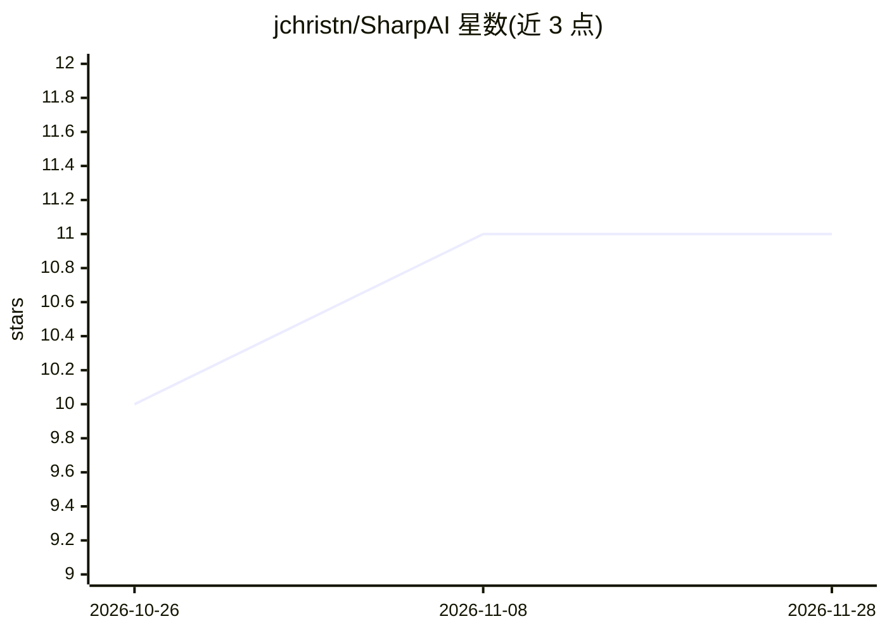

# jchristn/SharpAI

⭐ 11 · C# · MIT · 推送 2026-11-18 · [GitHub](https://github.com/jchristn/SharpAI) · 个人维护

**.NET 本地推理平台：GGUF 模型服务 + Ollama/OpenAI 兼容 API**

基于 .NET 的本地语言与嵌入模型运行平台，通过 LLamaSharp 调用 llama.cpp 运行 GGUF 模型。可作为共享推理服务器部署，提供 Ollama 兼容与 OpenAI 兼容 API、Web 仪表盘、终端仪表盘与 C#/JS/Python 三种 SDK；也可作为库嵌入 .NET 应用内自行管理模型生命周期。支持多租户与 bearer 凭证访问控制、SQLite/PostgreSQL 等存储、Docker 部署及单模型 Serve 工具。模型质量与速度取决于所选 GGUF 模型与硬件。

## 筛选速览

| 维度 | 判定 | 备注 |
|---|---|---|
| AI 角色 | `ai-ecosystem` | LLM/agent 周边工具 |
| 许可风险 | `permissive` | MIT |
| 部署形态 | `desktop` | 安装包/桌面程序 |
| 模型依赖 | local-ok | 支持本地模型 |
| 硬件要求 | — | 无带数字的原话,不猜 |
| 安装摩擦 | `low` | 无编译、无系统依赖或容器化 |
| 成熟度 | — | 结构信号不足 |

## 能力要点

- Ollama 兼容与 OpenAI 兼容 API，chat/completion/embedding/模型管理
- Web 仪表盘与 TUI 管理，含 playground、历史、观测与访问控制
- CPU 推理，支持 NVIDIA CUDA 与 Apple Silicon Metal 加速
- MIT 许可，可作为库嵌入 .NET 应用

## 适用场景

- 在自管基础设施内运行私有助手与内部工具
- 生成嵌入做语义检索或 RAG 的检索环节
- 团队共享的集中管理模型服务（租户/角色/权限）
- 在 .NET 桌面应用或服务中嵌入推理能力

## 场景标签

`推理引擎` · 领域:训练与推理

## 证据(README 行号)

> L10: Ollama-compatible and OpenAI-compatible APIs. SharpAI combines a local inference engine,
> L26: SharpAI is a .NET-based platform for running local language and embedding models in GGUF format.
> L29: - **Deploy an inference server.** Give applications a shared HTTP service with familiar chat,

## 星数曲线

2026-10-26 10 → 2026-11-28 11（+1）

---
*卡片 v1 · prompt 1.4 · 生成 2026-11-18 · 置信度 high · 依据 README sha `8f524351ba02` · [字段定义](../../DATASET.md)*
