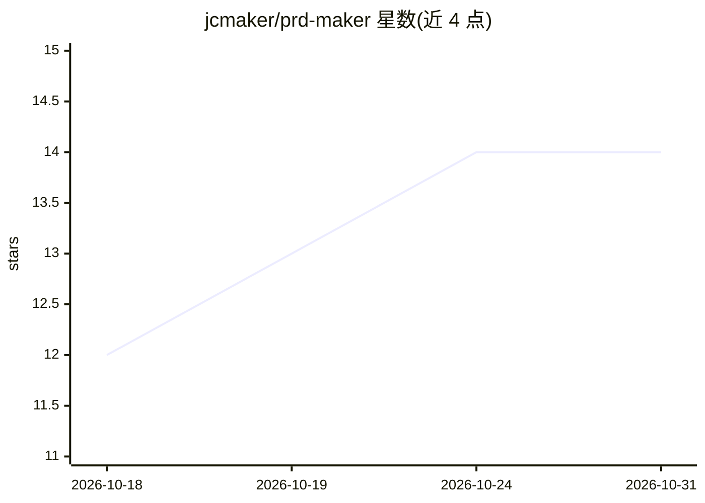

# jcmaker/prd-maker

⭐ 14 · Python · MIT · 推送 2026-08-19 · [GitHub](https://github.com/jcmaker/prd-maker) · 个人维护 · 中文 README

**通过对话式访谈生成 AI 编程代理可执行的 PRD.md 插件**

面向 Claude Code 与 Codex 的插件（也兼容 Cursor 等支持 Agent Skills 标准的工具），把“写一份代理能执行的 PRD”的方法固化为访谈流程与模板：从用户首条消息推断技术水平，区分开发者/非开发者两条提问路径，围绕 8 个必需要素逐一提问（最多 10 问），生成含明确非目标、可机器验证验收标准、分阶段范围的七节纯 markdown PRD。保存前由 Python 标准库脚本 validate_prd.py 做五项结构检查；另有 prd-to-html 把 PRD 转为离线单文件 HTML 供人阅读。非开发者可用，无外部依赖。

## 筛选速览

| 维度 | 判定 | 备注 |
|---|---|---|
| AI 角色 | `ai-ecosystem` | LLM/agent 周边工具 |
| 许可风险 | `permissive` | MIT |
| 部署形态 | `None` |  |
| 模型依赖 | — | README 未给出锁定关系 |
| 硬件要求 | — | 无带数字的原话,不猜 |
| 安装摩擦 | `low` | 无编译、无系统依赖或容器化 |
| 成熟度 | — | 结构信号不足 |

## 能力要点

- 自适应访谈：按用户技术水平切换开发者/非开发者提问路径，最多 10 问
- 输出七节纯 markdown PRD，含明确非目标与分阶段需求
- validate_prd.py 结构检查器（Python 标准库，五项确定性检查）
- prd-to-html 将 PRD 转为离线自包含 HTML 供人阅读

## 适用场景

- 不写代码的人通过回答问题获得一份可交给 AI 代理执行的 PRD
- 开发者在动手前用访谈固化范围、非目标与验收标准
- 把 PRD 转成 HTML 发给不使用终端的协作者阅读

## 场景标签

`AI 写作` · 领域:内容生成

## 证据(README 行号)

> L13: **Say your idea out loud, get a `PRD.md` any AI coding agent can execute — a plugin for Claude Code · Codex.**
> L223: The skill content (`SKILL.md` + `references/` + `scripts/`) follows the tool-agnostic **open Agent Skills standard

## 星数曲线

2026-10-18 12 → 2026-10-31 14（+2）

---
*卡片 v1 · prompt 1.4 · 生成 2026-10-31 · 置信度 high · 依据 README sha `21af77246ee0` · [字段定义](../../DATASET.md)*
