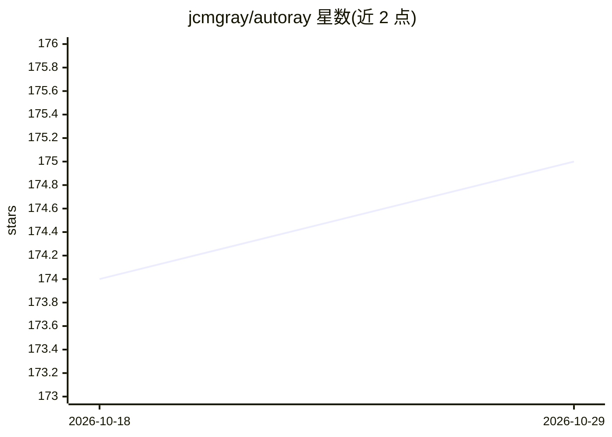

# jcmgray/autoray

⭐ 175 · Python · Apache-2.0 · 推送 2026-10-05 · [GitHub](https://github.com/jcmgray/autoray) · [官网](https://autoray.readthedocs.io) · 个人维护

**后端无关的张量运算抽象库：一套代码适配多个数组框架**

轻量级 Python 库，提供自动分发机制将数组运算抽象为后端无关代码，支持 numpy、pytorch、jax、cupy、mlx、dask、tensorflow、paddle 等后端，以及任何提供 numpy 风格 API 的库。核心接口 do 按函数名自动查找并缓存对应后端实现；也可导入 autoray.numpy 作为现有代码的直接替换，或用 get_namespace 获取带设备与 dtype 的命名空间对象。还支持按后端替换自定义函数、惰性追踪、中间量共享与常量折叠、统一接口编译，并可动态注册自定义后端与函数。面向需要在多个数组后端间复用代码的开发者。

## 筛选速览

| 维度 | 判定 | 备注 |
|---|---|---|
| AI 角色 | `ai-ecosystem` | LLM/agent 周边工具 |
| 许可风险 | `permissive` | Apache-2.0 |
| 部署形态 | `library` | 以包/库形式分发 |
| 模型依赖 | — | README 未给出锁定关系 |
| 硬件要求 | — | 无带数字的原话,不猜 |
| 安装摩擦 | `low` | 无编译、无系统依赖或容器化 |
| 成熟度 | — | 结构信号不足 |

## 能力要点

- do 接口按函数名自动分发并缓存对应后端实现
- 支持 numpy/pytorch/jax/tensorflow/paddle 等十余种后端及任意 numpy 风格 API 库
- autoray.numpy 模块可作为现有 numpy 代码的直接替换
- 支持自定义后端/函数动态注册、惰性追踪与中间量共享

## 适用场景

- 编写跨 numpy/pytorch/jax 等后端复用的数值计算代码
- 为特定后端替换自定义函数实现
- 以统一接口追踪或编译计算过程

## 场景标签

 · 领域:科学计算/机器学习基础设施

## 证据(README 行号)

> L10: `autoray` is a lightweight python AUTOmatic-arRAY library for
> L11: abstracting your tensor operations. Primarily it provides an

## 星数曲线

2026-10-18 174 → 2026-10-29 175（+1）

---
*卡片 v1 · prompt 1.4 · 生成 2026-10-22 · 置信度 high · 依据 README sha `a99efbd68fa3` · [字段定义](../../DATASET.md)*
