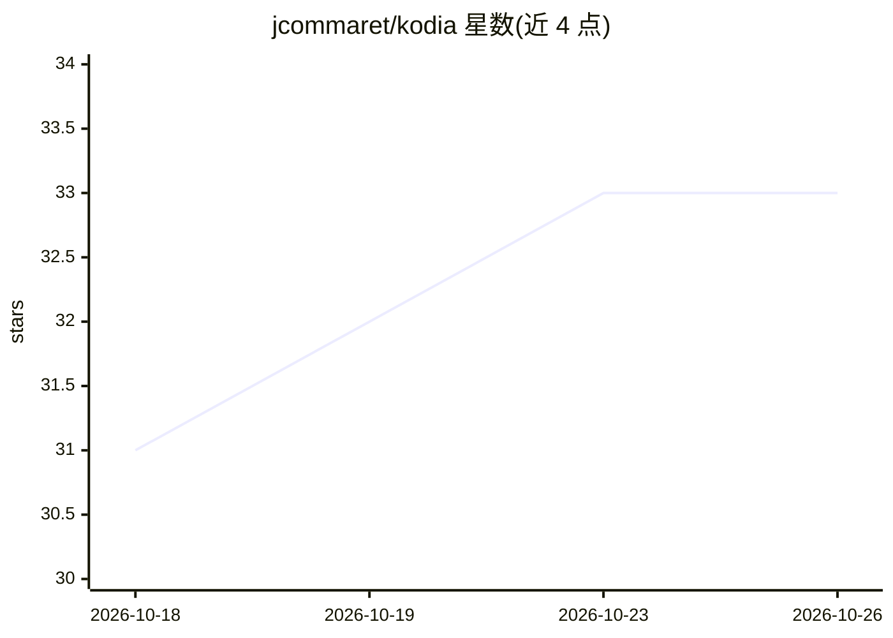

# jcommaret/kodia

⭐ 33 · TypeScript · Apache-2.0 · 推送 2026-10-23 · [GitHub](https://github.com/jcommaret/kodia) · 个人维护

**基于 VS Code 的 AI 代码编辑器，自带模型接入**

Kodia 是构建于 VS Code 之上的 AI 代码编辑器，起始为 Void（Cursor 的开源替代）的分支。用户自行配置模型：可直接连接云端服务商，或连接本机运行的模型，不经过 Kodia 服务器。功能包括三种模式的聊天侧栏、Ctrl+K 就地编辑与 diff 确认、检查点回滚、fill-in-the-middle 补全、长时间运行的 agent 会话、MCP 工具与项目记忆等。支持从 VS Code、Cursor 或 Windsurf 导入设置与扩展。桌面端从 releases 下载安装，也可用 Node.js 24.18.0 从源码构建。

## 筛选速览

| 维度 | 判定 | 备注 |
|---|---|---|
| AI 角色 | `ai-enhanced` | 去掉 AI 部分产品仍成立 |
| 许可风险 | `permissive` | Apache-2.0 |
| 部署形态 | `desktop` | 安装包/桌面程序 |
| 模型依赖 | local-ok | 支持本地模型 |
| 硬件要求 | — | 无带数字的原话,不猜 |
| 安装摩擦 | `low` | 无编译、无系统依赖或容器化 |
| 成熟度 | — | 结构信号不足 |

## 能力要点

- 直连用户配置的云端或本地模型，不经中间服务器
- Chat 三模式（Normal/Gather/Agent）与检查点回滚
- 支持 MCP 服务器、项目记忆与项目规则文件（.voidrules 等）
- 从 VS Code、Cursor 或 Windsurf 导入设置和扩展

## 适用场景

- 在编辑器内通过聊天与 agent 完成代码修改和命令执行
- 用本地模型（Ollama/LM Studio/vLLM）做代码补全与对话
- 从 Cursor 或 Windsurf 迁移现有设置继续开发

## 场景标签

`编码 Agent` `代码生成` · 领域:编码与开发

## 证据(README 行号)

> L5: Kodia is an AI code editor built on VS Code. It started as a fork of Void, the open-source alternative to Cursor.
> L7: You bring the models: Kodia talks directly to the providers you configure, or to models running on your machine, wit
> L11: - **Chat sidebar** with three modes: **Normal** (questions), **Gather** (reads and searches your code) and **Agent*

## 星数曲线

2026-10-18 31 → 2026-10-26 33（+2）

---
*卡片 v1 · prompt 1.4 · 生成 2026-10-25 · 置信度 high · 依据 README sha `f6dbfa1a00b9` · [字段定义](../../DATASET.md)*
