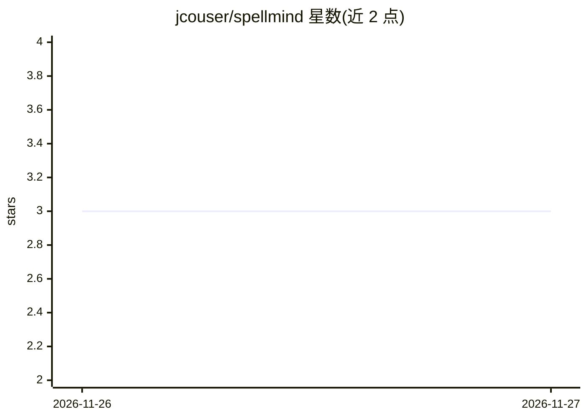

# jcouser/spellmind

⭐ 3 · JavaScript · NOASSERTION · 推送 2026-11-26 · [GitHub](https://github.com/jcouser/spellmind) · [官网](https://github.com/jcouser/spellmind) · 个人维护

**给魔兽世界玩家用的游戏内 AI 问答伴侣插件+桌面应用**

由插件与桌面应用两部分组成：插件本身无需 AI 即可提供任务路线规划（按任务日志生成最短顺序、等级过滤、副本与职业任务路线）、装备/天赋/法术/专业/金币面板与提示气泡；桌面应用（Windows 10/11）把玩家问题连同允许共享的游戏数据发送到用户自选的 AI，并把回答带回游戏聊天窗口，支持 Pin 地图坐标、网页搜索核对与路线复盘。声明为非官方、非暴雪出品，仅给建议不代玩。

## 筛选速览

| 维度 | 判定 | 备注 |
|---|---|---|
| AI 角色 | `ai-enhanced` | 去掉 AI 部分产品仍成立 |
| 许可风险 | `none` | NOASSERTION |
| 部署形态 | `desktop` | 安装包/桌面程序 |
| 模型依赖 | local-ok | 支持本地模型 |
| 硬件要求 | — | 无带数字的原话,不猜 |
| 安装摩擦 | `low` | 无编译、无系统依赖或容器化 |
| 成熟度 | — | 结构信号不足 |

## 能力要点

- 插件独立运行：任务路线、地图箭头与编号步骤，无需 AI
- 桌面应用接入用户自选的 AI（多家云端与本地模型）
- 回答基于真实角色数据，可一键 Pin 目标坐标到游戏地图
- 可选网页搜索对地名/NPC/路线做二次核对

## 适用场景

- 升级时按自己的任务日志规划任务路线与跨区域路线
- 游戏内直接询问装备取舍、天赋加点和拍卖行出售建议
- 让 AI 复盘我的路线并逐条解释可跳过的任务

## 场景标签

`聊天机器人` · 领域:对话与助手

## 证据(README 行号)

> L23: - **The addon**, in the game. It works on its own, with no app and no AI: a quest route built from your own quest l
> L24: - **The free desktop app** (Windows 10 and 11). It sends your question, with the game data you allow, to **your own
> L162: Pick your AI, its model and thinking level. It sits by the clock while you play, keeps the addon up to date and up

## 星数曲线

2026-11-26 3 → 2026-11-27 3（+0）

---
*卡片 v1 · prompt 1.4 · 生成 2026-11-26 · 置信度 high · 依据 README sha `fe4c88e0fdac` · [字段定义](../../DATASET.md)*
