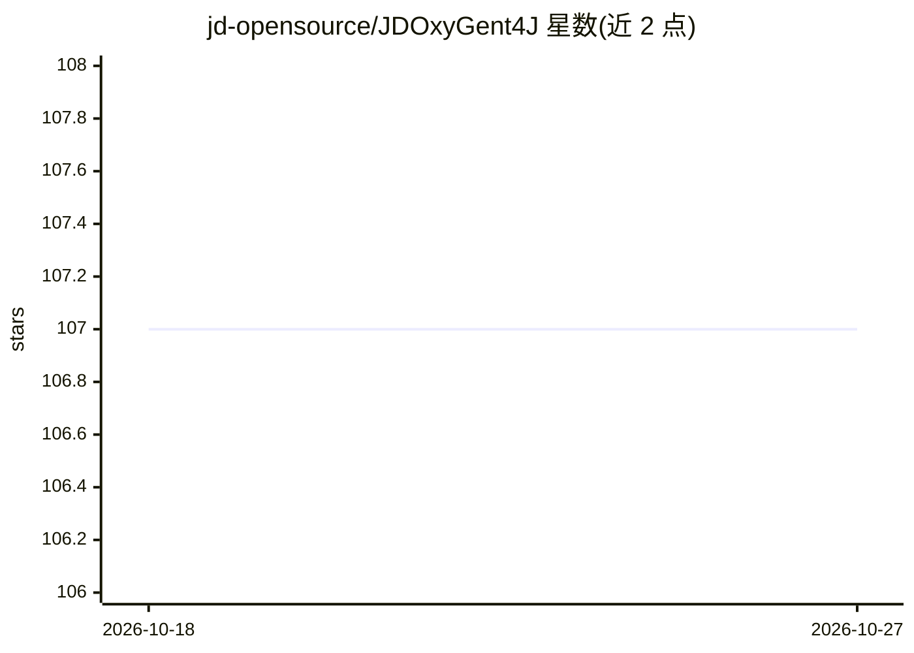

# jd-opensource/JDOxyGent4J

⭐ 107 · Java · NOASSERTION · 推送 2026-06-30 · [GitHub](https://github.com/jd-opensource/JDOxyGent4J) · [官网](https://oxygent.jd.com) · 组织维护 · 中文 README

**面向 Java 生态的多智能体框架，构建生产级智能系统**

OxyGent 的 Java 版本，将 Agent/LLM/Tool 统一为可组合的 Oxy 组件，提供端到端透明流水线与编排能力。针对 Java 生态优化：与 Spring Boot 集成、原生类型安全与编译期校验、基于 Java 并发模型的大规模异步 Agent 执行，支持访问控制、审计日志与可观测性。通过配置驱动适配本地/云/企业环境，存储层（数据库、缓存、向量库）可插拔。安装方式为 Maven 依赖或本地构建，要求 Java 17+、Maven 3.6+、Spring Boot 3.2.5+，需配置 LLM API key 与 JVM add-opens 参数，附 30+ 示例。

## 筛选速览

| 维度 | 判定 | 备注 |
|---|---|---|
| AI 角色 | `ai-ecosystem` | LLM/agent 周边工具 |
| 许可风险 | `none` | NOASSERTION |
| 部署形态 | `None` |  |
| 模型依赖 | — | README 未给出锁定关系 |
| 硬件要求 | — | 无带数字的原话,不猜 |
| 安装摩擦 | `medium` | 含编译或系统依赖之一 |
| 成熟度 | — | 结构信号不足 |

## 能力要点

- Agent/LLM/Tool 统一为可组合的 Oxy 组件
- Spring Boot 集成与 Java 原生类型安全、编译期校验
- 大规模并发 Agent 执行与非阻塞 IO 通信
- 存储层（数据库/缓存/向量库）可插拔扩展

## 适用场景

- 用 Java 技术栈构建生产级多智能体系统
- 在 Spring Boot 企业应用中接入 LLM Agent 能力
- 通过 30+ 示例学习主流 Agent 模式实现

## 场景标签

`多智能体` `Agent 框架` · 领域:Agent 开发

## 证据(README 行号)

> L24: OxyGent is an open-source multi-agent framework that unifies Agent/LLM/Tool as composable Oxy components, providing
> L26: JDOxyGent4J shares the same philosophy as the Python version and is deeply optimized for the Java ecosystem: native

## 星数曲线

2026-10-18 107 → 2026-10-27 107（+0）

---
*卡片 v1 · prompt 1.4 · 生成 2026-10-23 · 置信度 high · 依据 README sha `c6874809ca6f` · [字段定义](../../DATASET.md)*
