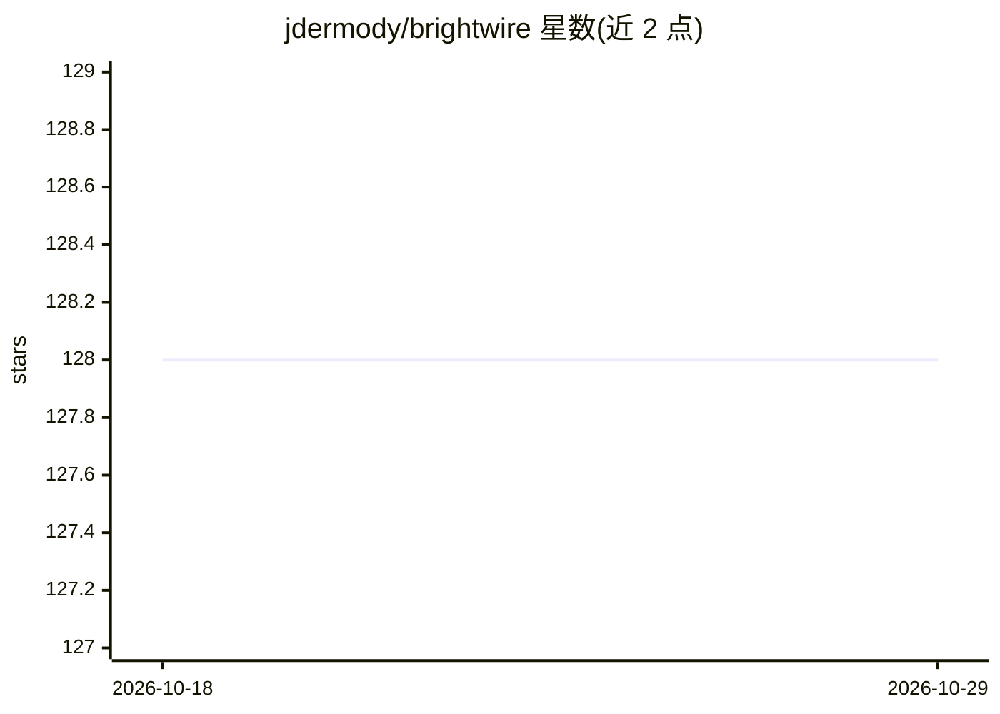

# jdermody/brightwire

⭐ 128 · C# · MIT · 推送 2026-08-21 · [GitHub](https://github.com/jdermody/brightwire) · [官网](https://github.com/jdermody/brightwire/wiki) · 个人维护

**.NET 机器学习库：神经网络/贝叶斯/聚类等多算法，可选 CUDA/MKL 加速**

面向 .NET 9 的可扩展机器学习类库，自带向量化线性代数库可开箱运行；支持前馈、卷积、双向与 seq2seq 网络架构及 LSTM/GRU 等循环网络，另含朴素贝叶斯、马尔可夫模型、K-Means/层次聚类、决策树、随机森林、KNN 与 Stacking 等算法。配置 NVIDIA GPU（Kepler 及以上）加 CUDA Toolkit 可启用 GPU 计算，Intel 平台可加 MKL 提升性能。通过 NuGet 安装，提供 MNIST、情感分析等系列教程。

## 筛选速览

| 维度 | 判定 | 备注 |
|---|---|---|
| AI 角色 | `ai-native` | 本体是模型或模型工具 |
| 许可风险 | `permissive` | MIT |
| 部署形态 | `None` |  |
| 模型依赖 | — | README 未给出锁定关系 |
| 硬件要求 | — | 无带数字的原话,不猜 |
| 安装摩擦 | `medium` | 含编译或系统依赖之一 |
| 成熟度 | — | 结构信号不足 |

## 能力要点

- 前馈/卷积/双向/seq2seq 架构与 LSTM、GRU 等循环网络
- 朴素贝叶斯、马尔可夫、聚类、决策树、随机森林、KNN、Stacking 等算法
- 自带向量化线性代数库，开箱即用；可选 CUDA GPU 与 Intel MKL 加速
- 支持内存与文件两种数据处理方式

## 适用场景

- 在 .NET 项目中训练分类、回归与序列模型
- MNIST 手写数字识别、情感分析、文本聚类等任务
- 利用 NVIDIA GPU 加速模型训练

## 场景标签

`模型训练` · 领域:训练与推理

## 证据(README 行号)

> L3: *Bright Wire* is an extensible machine learning library for .NET with optional MKL and GPU support (via CUDA).
> L60: * Feed Forward, Convolutional, Bidirectional and Sequence to Sequence (seq2seq) network architectures

## 星数曲线

2026-10-18 128 → 2026-10-29 128（+0）

---
*卡片 v1 · prompt 1.4 · 生成 2026-10-22 · 置信度 high · 依据 README sha `ba735b45a8d5` · [字段定义](../../DATASET.md)*
