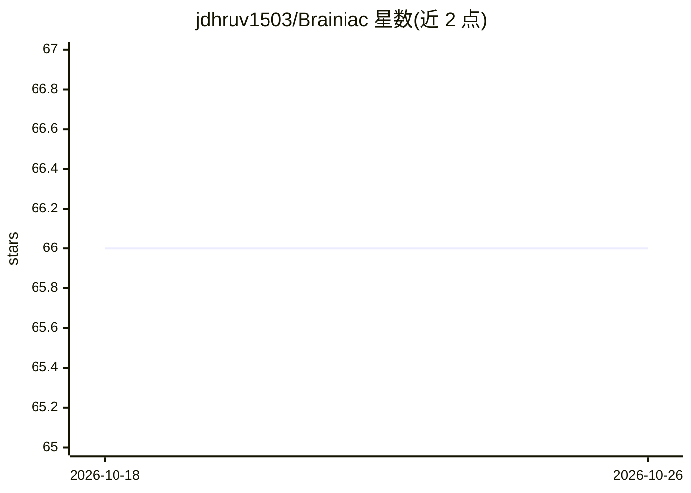

# jdhruv1503/Brainiac

⭐ 66 · Python · 推送 2026-07-25 · [GitHub](https://github.com/jdhruv1503/Brainiac) · 个人维护

**AI 代理驱动的量化 alpha 生成器：自动研读论文、生成并回测 alpha**

面向量化分析师与交易者的 agentic 工具：自动抓取和分析金融研究论文，用 LangChain 强化学习框架生成与优化 alpha，转换为 WorldQuant Fast Expression 语言，通过 RAG 检索匹配数据集，并在 WorldQuant BRAIN 平台自动回测，结果存入 SQLite 数据库。运行需要 LlamaParse 和 DeepInfra 的 API key，以及 WorldQuant BRAIN 账号。使用方式为以 git clone 源码安装，后台运行模拟 API 后由 watchdog 脚本监控 PDF 与策略文件夹触发生成。

## 筛选速览

| 维度 | 判定 | 备注 |
|---|---|---|
| AI 角色 | `ai-ecosystem` | LLM/agent 周边工具 |
| 许可风险 | `none` | — |
| 部署形态 | `None` |  |
| 模型依赖 | — | README 未给出锁定关系 |
| 硬件要求 | — | 无带数字的原话,不猜 |
| 安装摩擦 | `low` | 无编译、无系统依赖或容器化 |
| 成熟度 | — | 结构信号不足 |

## 能力要点

- 抓取金融研究论文并用 NLP 提取可操作洞察生成 alpha
- LangChain 强化学习框架优化 alpha，RAG 检索匹配数据集
- 转换为 WorldQuant Fast Expression 并在 BRAIN 平台自动回测
- 结果系统化存入 SQLite 数据库

## 适用场景

- 我想从研究论文自动提炼并回测量化 alpha
- 希望接入 WorldQuant BRAIN 自动跑回测并归档结果
- 用 agentic 流程批量迭代金融交易策略

## 场景标签

`金融量化` `RAG` · 领域:知识与检索

## 证据(README 行号)

> L9: - **Agentic AI System**: Utilizes a cutting-edge AI framework for autonomous scraping and analysis of financial rese
> L10: - **LangChain Integration**: Employs LangChain to foster an agentic reinforcement learning framework, enhancing the
> L12: - **Automated Backtesting**: Seamlessly integrates with WorldQuant's BRAIN platform, enabling automated backtesting

## 星数曲线

2026-10-18 66 → 2026-10-26 66（+0）

---
*卡片 v1 · prompt 1.4 · 生成 2026-10-24 · 置信度 mid · 依据 README sha `8cbe67fb259e` · [字段定义](../../DATASET.md)*
