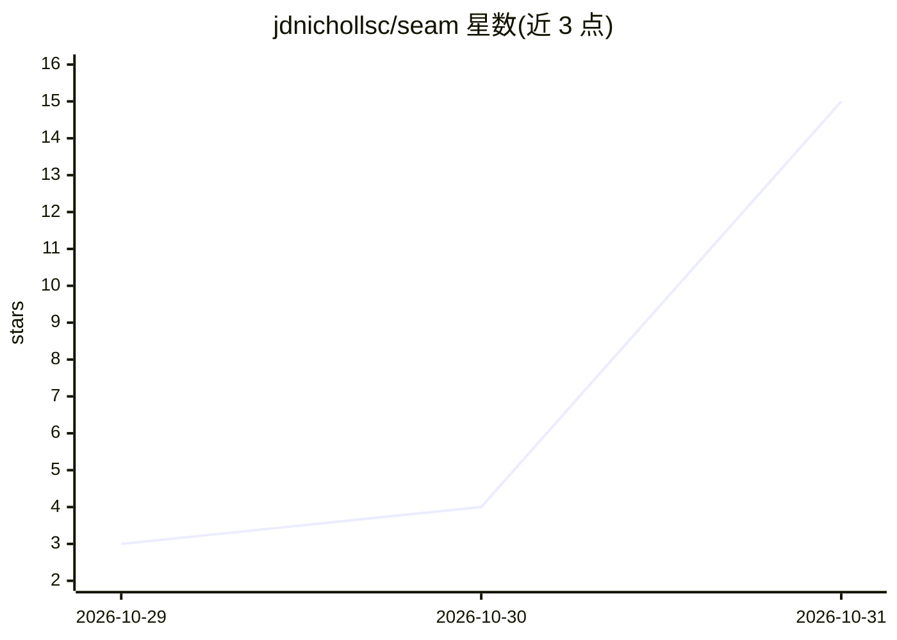

# jdnichollsc/seam

⭐ 15 · Python · MIT · 推送 2026-10-30 · [GitHub](https://github.com/jdnichollsc/seam) · [官网](https://jdnichollsc.github.io/seam/) · 个人维护

**本地 GPU 视频转场生成器：两图/两片段/3D 模型生成 AI 过渡**

面向创作者与开发者的开源视频转场工具：输入两张图片、两段 1-6 秒片段或两个 .glb 3D 模型，用 LTX-2.5 开放权重模型在本机 GPU 上经 ComfyUI 渲染中间过渡视频（烟雾、水波、甩镜等 10 种效果）。提供 Web 工作台、CLI 与 MCP agent 插件（Claude Code 可用），支持多镜头序列与逐段补渲，每次生成存档为可复现的 ComfyUI 工作流。限制：需 NVIDIA 32 GB 显存 GPU、64 GB RAM，仅 Windows 11 + RTX 5090 测试过。

## 筛选速览

| 维度 | 判定 | 备注 |
|---|---|---|
| AI 角色 | `ai-native` | 本体是模型或模型工具 |
| 许可风险 | `permissive` | MIT |
| 部署形态 | `None` |  |
| 模型依赖 | — | README 未给出锁定关系 |
| 硬件要求 | — | 无带数字的原话,不猜 |
| 安装摩擦 | `medium` | 含编译或系统依赖之一 |
| 成熟度 | `idea` | |

## 能力要点

- LTX-2.5 开放权重本地渲染，10 种合格转场效果
- 支持图片、片段与 .glb 3D 模型（three.js 取景与轨道录制）输入
- Web 工作台 + CLI + MCP agent 插件（含序列扩展与编辑命令）
- 每次生成存档为可复现的 ComfyUI 工作流（receipt 含 seed 与图哈希）

## 适用场景

- 把两个镜头生成为一段 AI 过渡视频用于剪辑
- 按顺序排布多张图，逐段生成并拼接成完整短片
- 让 Claude Code 通过 MCP 规划、渲染并迭代转场

## 场景标签

`视频生成` · 领域:内容生成

## 证据(README 行号)

> L5:  Drop two images, two clips or two 3D models. Pick an effect. An open-weights video model renders the in-between
> L6:  on your own GPU, through ComfyUI. Every take is a ComfyUI workflow you can open.
> L110: |Category fit|**Open Weights Only**: every render is LTX-2.5 (+ Gemma-4 E2B to read the shots) on your own GPU thr

## 星数曲线

2026-10-29 3 → 2026-10-31 15（+12）

---
*卡片 v1 · prompt 1.4 · 生成 2026-10-30 · 置信度 high · 依据 README sha `d2eed852c8c1` · [字段定义](../../DATASET.md)*
