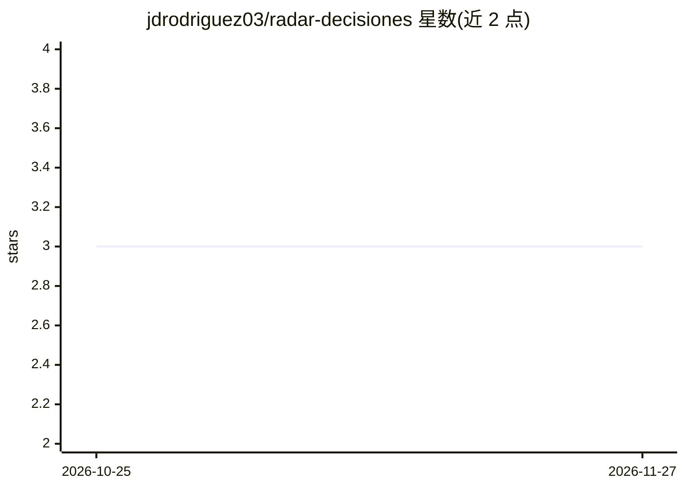

# jdrodriguez03/radar-decisiones

⭐ 3 · Python · MIT · 推送 2026-10-21 · [GitHub](https://github.com/jdrodriguez03/radar-decisiones) · 组织维护

**HR 决策者对照 40 家真实企业薪酬决策并获 AI 解释的工具**

面向人力资源负责人的薪酬决策比较工具：调整五项薪酬杠杆后，与双月度调研中 40 家真实匿名企业按是否已采取该措施分成两组，比较年度流失率、前三月离职与缺勤，用 Mann-Whitney 检验给出证据强度信号，并计算成本。AI 部分生成三句话解释，输入仅限计算引擎输出的 JSON，经校验器剔除任何未出现在计算中的数字；模型超时或无网络时回退到模板解释。Streamlit 运行，支持离线模式与 PDF 报告导出。

## 筛选速览

| 维度 | 判定 | 备注 |
|---|---|---|
| AI 角色 | `ai-enhanced` | 去掉 AI 部分产品仍成立 |
| 许可风险 | `permissive` | MIT |
| 部署形态 | `library` | 以包/库形式分发 |
| 模型依赖 | locked-api |  |
| 硬件要求 | — | 无带数字的原话,不猜 |
| 安装摩擦 | `low` | 无编译、无系统依赖或容器化 |
| 成熟度 | — | 结构信号不足 |

## 能力要点

- 五项薪酬杠杆即时重算并对比 40 家真实企业分组的中位数
- AI 解释经校验器约束，仅使用计算结果中已有的数字
- 模型超时/无网络时自动回退模板解释，支持离线演示模式
- 场景保存对比并下载 PDF 报告，证据强度用 Mann-Whitney p 值分级

## 适用场景

- 评估调整某项福利后企业流失率相对同业的变化
- 向委员会演示薪酬方案并导出对比报告
- 无网络环境下离线展示测算结果

## 场景标签

 · 领域:人力资源/决策支持

## 证据(README 行号)

> L3: Herramienta para que un directivo de recursos humanos pruebe una decisión de compensación y vea, en segundos, qué mu
> L14: - **Explicación con IA** que nunca muestra una cifra que no esté en el cálculo, con respaldo automático si el model
> L76: El resultado del motor es un JSON con estructura fija, validado contra `contrato/modelo.py`. La IA recibe solo ese 

## 星数曲线

2026-10-25 3 → 2026-11-27 3（+0）

---
*卡片 v1 · prompt 1.4 · 生成 2026-11-21 · 置信度 high · 依据 README sha `fa0aa8993c1f` · [字段定义](../../DATASET.md)*
