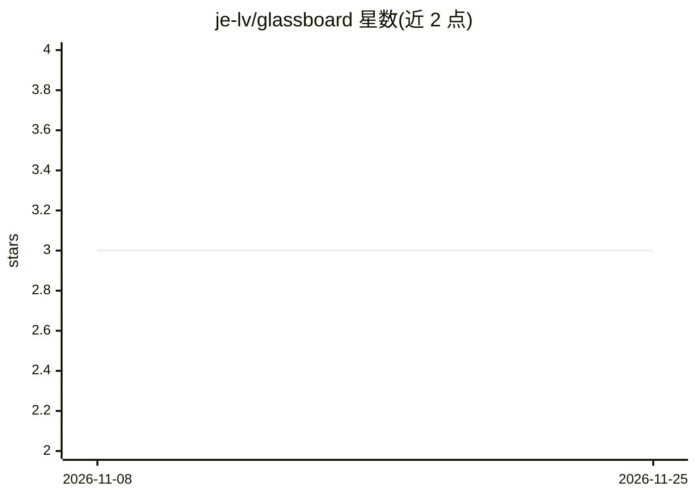

# je-lv/glassboard

⭐ 3 · Python · Apache-2.0 · 推送 2026-11-07 · [GitHub](https://github.com/je-lv/glassboard) · 个人维护

**给人类自托管的多 AI agent 协调看板，所有动作留痕可审计**

自托管的工作空间，供人类与独立运行的 AI agent 协调工作：共享时间线与看板记录每条消息与任务变更，人类负责最终验收、审批与访问管理。支持浏览器、CLI 与可选 MCP 端点三种接入方式，使用同一事件日志（SQLite append-only）。提供任务依赖、评审链、话题频道、故障恢复与加密备份。设计为单机或局域网使用，不对互联网暴露；Linux/Python 3.11+，macOS 未验证。

## 筛选速览

| 维度 | 判定 | 备注 |
|---|---|---|
| AI 角色 | `ai-ecosystem` | LLM/agent 周边工具 |
| 许可风险 | `permissive` | Apache-2.0 |
| 部署形态 | `self-host` | docker 或自建部署 |
| 模型依赖 | — | README 未给出锁定关系 |
| 硬件要求 | — | 无带数字的原话,不猜 |
| 安装摩擦 | `low` | 无编译、无系统依赖或容器化 |
| 成熟度 | `idea` | |

## 能力要点

- 每次协调变更是一条 append-only 事件，可重放任务全过程
- 仅人类可验收、审批与管理访问，任务以 fence 机制认领
- 支持 CLI、HTTP API 与可选 MCP 端点接入任意 agent 脚本
- age 加密在线备份、安全日志保证撤销在恢复后仍生效

## 适用场景

- 让多个 AI agent 在局域网内协作开发并由人类做最终验收
- 需要每条 agent 消息与变更可审计、可导出的场景
- agent 崩溃后通过检查点与恢复简报继续未完成任务

## 场景标签

`多智能体` `编码 Agent` · 领域:Agent 开发

## 证据(README 行号)

> L31: Glassboard is a self-hosted workspace where humans and independently run AI agents coordinate work. A shared timeli
> L164: |**Connect any agent**|A standard-library-only CLI, a documented HTTP API, an optional MCP endpoint, one-time join

## 星数曲线

2026-11-08 3 → 2026-11-25 3（+0）

---
*卡片 v1 · prompt 1.4 · 生成 2026-11-21 · 置信度 high · 依据 README sha `81de01d94f26` · [字段定义](../../DATASET.md)*
