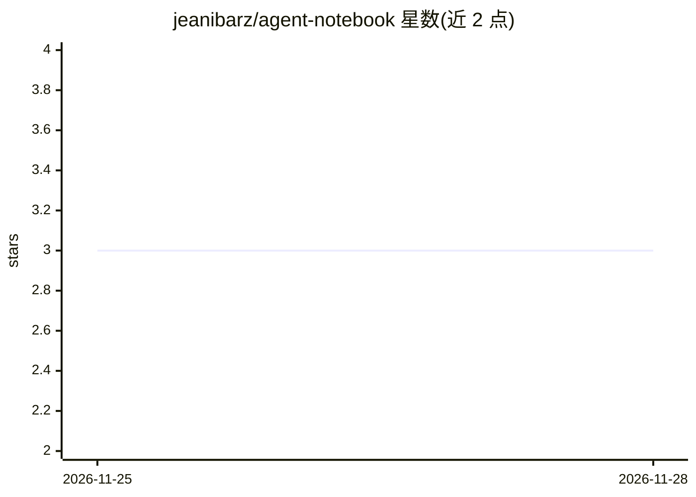

# jeanibarz/agent-notebook

⭐ 3 · TypeScript · MIT · 推送 2026-11-27 · [GitHub](https://github.com/jeanibarz/agent-notebook) · [官网](https://www.npmjs.com/package/agent-notebook) · 个人维护

**给 AI Agent 提供纯文本跨任务记忆的 CLI**

一个以纯文本文件存储 Agent 经验教训的命令行工具：每个 shelf 为一个有上限的文本文件（默认 50 行、每行≤200 字符），任务开始时由 harness（如 Claude Code、Codex CLI）让 Agent 读入整份清单，任务结束后由 Agent 对有用条目投票并在满员时按最低分驱逐旧行。无嵌入、无向量数据库、无网络调用；文件可 cat/grep/diff，可选纳入 git 追踪变更。安装需 Node.js 18+，无运行时依赖。

## 筛选速览

| 维度 | 判定 | 备注 |
|---|---|---|
| AI 角色 | `ai-ecosystem` | LLM/agent 周边工具 |
| 许可风险 | `permissive` | MIT |
| 部署形态 | `library` | 以包/库形式分发 |
| 模型依赖 | — | README 未给出锁定关系 |
| 硬件要求 | — | 无带数字的原话,不猜 |
| 安装摩擦 | `low` | 无编译、无系统依赖或容器化 |
| 成熟度 | `idea` | |

## 能力要点

- 投票评分加近期使用感知的驱逐机制，文件有上限
- 纯文本存储，支持 cat/grep/diff 与可选 git 版本追踪
- 无嵌入、无向量库、无网络调用，本地离线 CLI
- 提供 Claude Code 与 Codex CLI 的接入说明与可选 hooks

## 适用场景

- 让 Agent 跨会话记住踩过的坑（如构建前先跑 lint）
- 给多个 Agent 项目维护各自的经验清单
- 用 git 审查 Agent 保留或修改的每条经验

## 场景标签

`Agent 记忆` · 领域:Agent 开发

## 证据(README 行号)

> L3: **Small memory, on purpose.** A plain-text memory for AI agents: a capped file of voted one-line lessons. No embeddi
> L85: `nb` is a **store, not a loop.** It never runs itself: install it and walk away, and nothing happens: no lesson is 

## 星数曲线

2026-11-25 3 → 2026-11-28 3（+0）

---
*卡片 v1 · prompt 1.4 · 生成 2026-11-24 · 置信度 high · 依据 README sha `6a56744444b7` · [字段定义](../../DATASET.md)*
