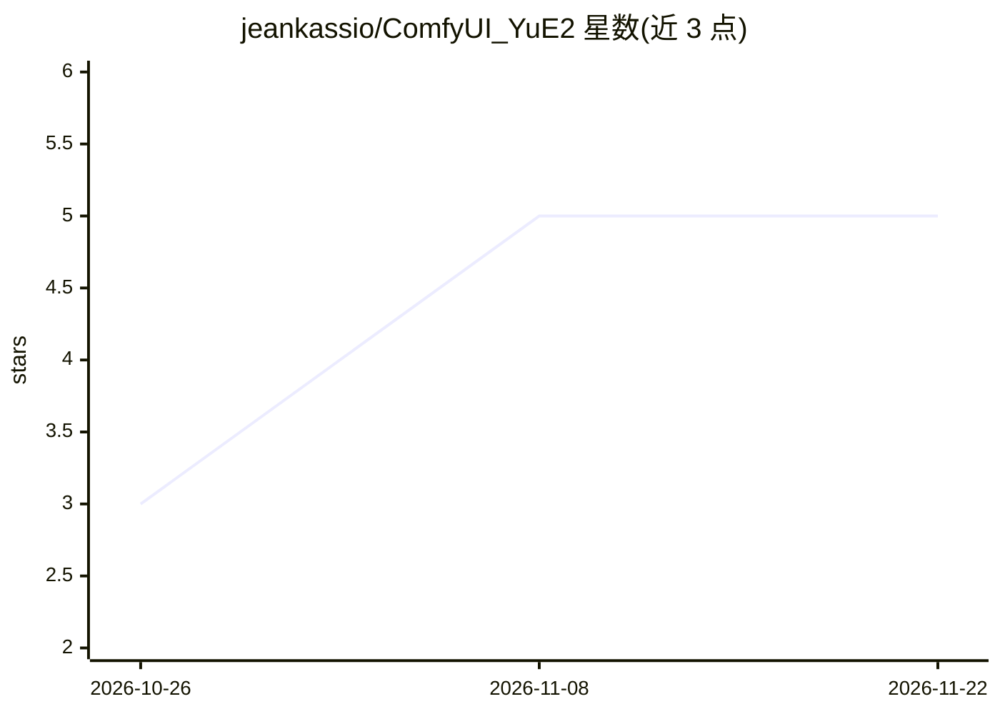

# jeankassio/ComfyUI_YuE2

⭐ 5 · Python · MIT · 推送 2026-10-15 · [GitHub](https://github.com/jeankassio/ComfyUI_YuE2) · [官网](https://somora.media) · 个人维护

**在 ComfyUI 中运行官方 YuE2 文生音乐管线的节点包**

作为 ComfyUI custom_nodes 插件接入官方 YuE2 Python 推理引擎（固定 v0.1.6 与官方 Hugging Face 权重），提供模型加载、风格/歌词输入、ABC 符号规划、语义生成、声学合成、立体声解码及音频翻录 cover 等节点；通过 bat/sh 启动器在隔离 venv 中安装引擎并按修订与 SHA256 校验下载共 11.08 GB 模型文件。生成输出 48 kHz 立体声音频；GPU 推荐起点为 BF16、24 GB 显存，亦支持 CPU/MPS 路径。生成功能已在 Windows/RTX 3090 上验证。

## 筛选速览

| 维度 | 判定 | 备注 |
|---|---|---|
| AI 角色 | `ai-native` | 本体是模型或模型工具 |
| 许可风险 | `permissive` | MIT |
| 部署形态 | `desktop` | 安装包/桌面程序 |
| 模型依赖 | local-ok | 支持本地模型 |
| 硬件要求 | `gpu-24g` | |
| 安装摩擦 | `medium` | 含编译或系统依赖之一 |
| 成熟度 | — | 结构信号不足 |

## 能力要点

- 接入官方 YuE2 v0.1.6 引擎，保留未经量化的官方权重与配置
- 四个示例工作流覆盖文生音乐、分阶段生成、乐谱编辑与音频翻录
- 模型下载按修订固定并校验 SHA256，支持 --check 离线完整性检查
- 可选 SheetSage2 转录环境将源音频转为 ABC 乐谱用于 cover

## 适用场景

- 在 ComfyUI 画布上用风格与歌词生成歌曲
- 编辑 ABC 乐谱后让模型按谱生成演奏
- 上传源歌曲生成可改编伴奏的翻录作品

## 场景标签

 · 领域:AI 音乐生成/媒体创作

## 证据(README 行号)

> L7: ComfyUI nodes for **the official YuE2 Python pipeline**: model loading, style/lyrics input, symbolic composition, se
> L113: |Official Generate Music|Complete official pipeline; returns 48 kHz stereo AUDIO, ABC and a JSON report.|

## 星数曲线

2026-10-26 3 → 2026-11-22 5（+2）

---
*卡片 v1 · prompt 1.4 · 生成 2026-11-21 · 置信度 mid · 依据 README sha `cf50e03f3ec9` · [字段定义](../../DATASET.md)*
