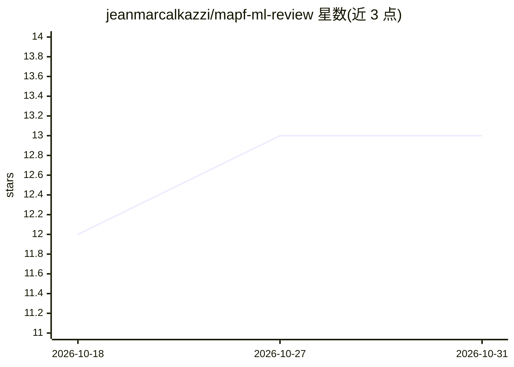

# jeanmarcalkazzi/mapf-ml-review

⭐ 13 · TeX · 推送 2026-07-04 · [GitHub](https://github.com/jeanmarcalkazzi/mapf-ml-review) · [官网](https://jeremarc.com/projects/mapf-ml-review/) · 个人维护

**ML 求解多智能体路径规划（MAPF）论文的持续跟踪综述清单**

一份活体综述（living survey），追踪用机器学习方法求解多智能体路径规划（MAPF）问题的研究论文，基于 Alkazzi & Okumura 发表于 IEEE Access 2024 的综述并持续更新（最近更新 2026-06，单次新增 79 篇）。条目按研究主题组织为表示（环境优化/生成、算法选择）、规划（增强 CBS/优先级规划/其他求解器、学习式策略分集中式与去中心化）、执行等章节，每条含论文题名、发表会议/期刊、年份及论文/代码/项目链接，并提供全部 BibTeX 与更新日志。面向 MAPF 与机器人规划方向的研究者。

## 筛选速览

| 维度 | 判定 | 备注 |
|---|---|---|
| AI 角色 | `ai-knowledge` | 知识聚合/清单类 |
| 许可风险 | `none` | — |
| 部署形态 | `None` |  |
| 模型依赖 | — | README 未给出锁定关系 |
| 硬件要求 | — | 无带数字的原话,不猜 |
| 安装摩擦 | `low` | 无编译、无系统依赖或容器化 |
| 成熟度 | — | 结构信号不足 |

## 能力要点

- 按 OQ 组织问题分类，覆盖表示/规划/执行三大环节
- 每条含 venue、年份与 paper/code/project 等链接
- 持续更新并附带 changelog 与全部 BibTeX

## 适用场景

- 查找 MAPF 领域强化学习/模仿学习/扩散模型的最新论文
- 按'增强现有求解器'或'学习式策略'等主题做文献调研
- 获取可直接跟进的开源代码与数据集条目

## 场景标签

`科研工具` `精选清单` · 领域:学习与行业

## 证据(README 行号)

> L1: # A (LIVE) Comprehensive Review on Leveraging Machine Learning for Multi-Agent Path Finding
> L3: A living survey tracking Machine Learning approaches to solving the MAPF Problem.
> L11: 📋 Changelog — latest: `2026.06` (+79 papers)

## 星数曲线

2026-10-18 12 → 2026-10-31 13（+1）

---
*卡片 v1 · prompt 1.4 · 生成 2026-10-31 · 置信度 high · 依据 README sha `2394e293b02e` · [字段定义](../../DATASET.md)*
