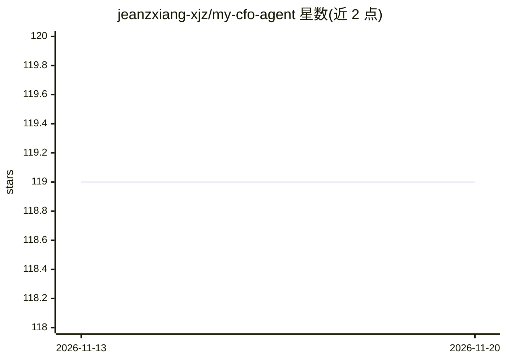

# jeanzxiang-xjz/my-cfo-agent

⭐ 119 · Python · MIT · 推送 2026-11-14 · [GitHub](https://github.com/jeanzxiang-xjz/my-cfo-agent) · 个人维护 · 中文 README

**自托管多用户个人记账 Agent：截图自动入账并可对话分析**

自托管的私人财务 CFO Agent：iPhone 快捷指令截图经 HTTPS 直传服务端，本地 RapidOCR 识别后由规则解析金额、时间、商户，幂等写入每人独立的 SQLite 账本；分类由本地规则、商户记忆与 DeepSeek 共同补全，Web 界面提供多周期统计、趋势与预算，并支持基于裁剪账本上下文的 LLM 对话问答。OCR 默认离线完成，可选 macOS Vision 或阿里云 OCR 后端。需自备 DeepSeek API Key，本地 LLM 支持在 Roadmap 中尚未实现。

## 筛选速览

| 维度 | 判定 | 备注 |
|---|---|---|
| AI 角色 | `ai-native` | 本体是模型或模型工具 |
| 许可风险 | `permissive` | MIT |
| 部署形态 | `library` | 以包/库形式分发 |
| 模型依赖 | — | README 未给出锁定关系 |
| 硬件要求 | — | 无带数字的原话,不猜 |
| 安装摩擦 | `low` | 无编译、无系统依赖或容器化 |
| 成熟度 | — | 结构信号不足 |

## 能力要点

- 快捷指令截图直传 + 本地 RapidOCR 离线识别账单
- 规则解析生成交易唯一 ID，重复上传幂等去重
- 每人独立 SQLite 账本目录，物理隔离数据
- 对话仅注入裁剪后的账本上下文，原始证据可回溯

## 适用场景

- 支付后点一下快捷指令，账单截图自动入账
- 直接向账本提问，如「这个月最大支出是什么」
- 家庭或小团体一套部署各自独立记账与预算管理

## 场景标签

`OCR` `AI 助手` · 领域:对话与助手

## 证据(README 行号)

> L9: 一个自托管（Self-hosted）、支持多用户的私人财务 CFO Agent：
> L52: |💬|**可对话的账本**|接入 DeepSeek，直接问「这个月最大的支出是什么」，回答基于真实账本数据|

## 星数曲线

2026-11-13 119 → 2026-11-20 119（+0）

---
*卡片 v1 · prompt 1.4 · 生成 2026-11-17 · 置信度 mid · 依据 README sha `5b3f66f810a9` · [字段定义](../../DATASET.md)*
