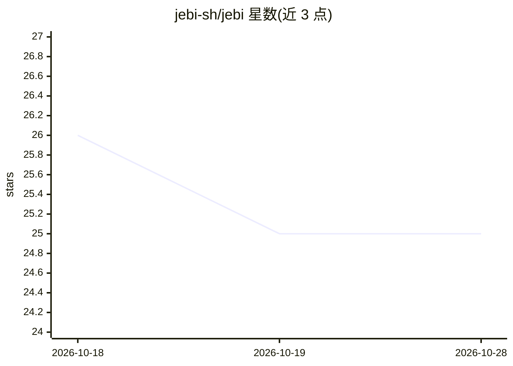

# jebi-sh/jebi

⭐ 25 · JavaScript · MIT · 推送 2026-08-09 · [GitHub](https://github.com/jebi-sh/jebi) · [官网](https://jebi.sh) · 组织维护

**带本地 AI 的 macOS 终端：错误解释、命令建议与 /ask 问答**

基于 Electron/xterm.js 的 Mac 终端模拟器，功能包括多标签、分屏、智能提示段（git/Node/Go/Python/Docker/K8s）、命令历史、7 种主题、斜杠命令与自定义命令。AI 部分：命令失败后解释原因、自然语言转 shell 命令、每次运行后给出 3 条可点击建议，全部通过 llama.cpp 在本机运行，无需 API key 或联网；内置 7 个可选模型（Qwen3、Gemma 3、Qwen2.5-Coder 等）按需下载。要求 Apple Silicon 与 macOS 14+，经 Homebrew Cask 或 DMG 安装。

## 筛选速览

| 维度 | 判定 | 备注 |
|---|---|---|
| AI 角色 | `ai-enhanced` | 去掉 AI 部分产品仍成立 |
| 许可风险 | `permissive` | MIT |
| 部署形态 | `desktop` | 安装包/桌面程序 |
| 模型依赖 | — | README 未给出锁定关系 |
| 硬件要求 | — | 无带数字的原话,不猜 |
| 安装摩擦 | `low` | 无编译、无系统依赖或容器化 |
| 成熟度 | — | 结构信号不足 |

## 能力要点

- 命令失败解释与自然语言转 shell 命令
- 每次运行后 3 条可点击的下一步命令建议
- AI 经 llama.cpp 本机运行，无需 API key/云端
- 7 个内置模型按需下载并在 Preferences 中管理
- 智能提示段显示 git/Node/Go/Python/Docker/K8s 状态

## 适用场景

- 命令报错时直接获得原因解释和修复方法
- 用自然语言描述想做的事并得到可运行的命令
- 不依赖云服务在终端内做本地 AI 问答

## 场景标签

`AI 助手` `代码生成` · 领域:编码与开发

## 证据(README 行号)

> L10: jebi is a terminal emulator for Mac with built-in local AI. It explains failed commands, suggests what to run next,
> L20: - **No API key, no subscription, no cloud** — AI runs entirely on your Mac via llama.cpp

## 星数曲线

2026-10-18 26 → 2026-10-28 25（-1）

---
*卡片 v1 · prompt 1.4 · 生成 2026-10-27 · 置信度 high · 依据 README sha `06f2c76b39f3` · [字段定义](../../DATASET.md)*
