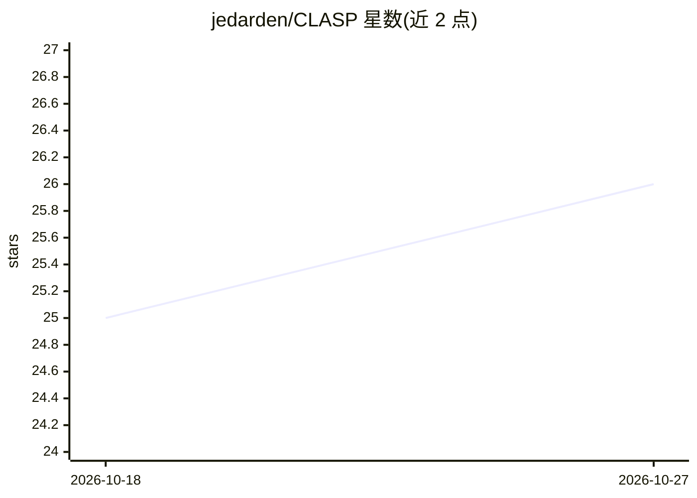

# jedarden/CLASP

⭐ 26 · Go · MIT · 推送 2026-10-26 · [GitHub](https://github.com/jedarden/CLASP) · [官网](https://jedarden.com/projects/clasp/) · 个人维护

**让 Claude Code 接入任意 LLM 提供商的 Go 代理**

Go 编写的轻量代理，部署在 Claude Code 与用户选择的 LLM 提供商之间，实时将 Anthropic Messages API 翻译为 OpenAI Chat Completions API。支持 OpenAI、Azure、OpenRouter 及 Ollama/vLLM/LM Studio 等自定义端点，无需修改或 fork Claude Code，仅设置 ANTHROPIC_BASE_URL 即可使用。支持 SSE 流式、工具调用翻译、多提供商按 Claude 模型层级路由、响应缓存、限流、请求排队、API key 鉴权与 Prometheus 指标。提供 npm/npx、go install、源码与 Docker 安装方式。

## 筛选速览

| 维度 | 判定 | 备注 |
|---|---|---|
| AI 角色 | `ai-ecosystem` | LLM/agent 周边工具 |
| 许可风险 | `permissive` | MIT |
| 部署形态 | `self-host` | docker 或自建部署 |
| 模型依赖 | local-ok | 支持本地模型 |
| 硬件要求 | — | 无带数字的原话,不猜 |
| 安装摩擦 | `low` | 无编译、无系统依赖或容器化 |
| 成熟度 | — | 结构信号不足 |

## 能力要点

- Anthropic Messages API ↔ OpenAI Chat Completions 实时协议翻译
- 多提供商支持：OpenAI、Azure、OpenRouter 及 Ollama/vLLM/LM Studio 自定义端点
- Opus/Sonnet/Haiku 层级可路由到不同提供商与模型
- 响应缓存、限流、请求排队、API key 鉴权与 Prometheus 指标端点

## 适用场景

- 用 OpenAI/Gemini 等非 Anthropic 模型驱动 Claude Code
- 按任务复杂度将不同 Claude 层级路由到不同提供商以控制成本
- 让 Claude Code 调用本地 Ollama/vLLM 模型

## 场景标签

`模型网关` · 领域:Agent 开发

## 证据(README 行号)

> L3: Run Claude Code against any LLM provider — OpenAI, Azure, Gemini, Ollama, vLLM, or any OpenAI-compatible endpoint. C
> L15: - **Full Protocol Translation**: Anthropic Messages API ↔ OpenAI Chat Completions API
> L241: |`POST /v1/messages`|Anthropic Messages API (translated)|

## 星数曲线

2026-10-18 25 → 2026-10-27 26（+1）

---
*卡片 v1 · prompt 1.4 · 生成 2026-10-27 · 置信度 high · 依据 README sha `e8591208da87` · [字段定义](../../DATASET.md)*
