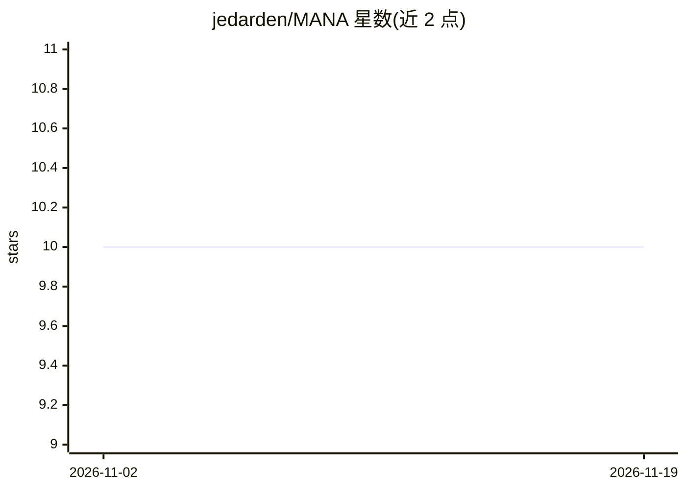

# jedarden/MANA

⭐ 10 · Rust · MIT · 推送 2026-09-24 · [GitHub](https://github.com/jedarden/MANA) · [官网](https://jedarden.com/projects/mana/) · 个人维护

**为 Claude Code 提供模式记忆与上下文注入的 Rust 工具**

Rust 编写的 CLI 与后台守护进程，通过 Claude Code 的 hook 系统工作：会话结束时解析 transcript 为轨迹，提取可复用模式并存入 SQLite；工具运行前由 PreToolUse hook 经 Unix socket 查询守护进程，将相似模式打印注入上下文，延迟预算 10 ms。带按模式成功率/使用/新鲜度的排序与剪枝、共现图谱、失败反思、跨工作区同步（git/S3/Supabase/P2P，AES-256-GCM 加密）。嵌入为 TF-IDF 风格哈希向量，非 transformer 模型；九个强化学习模块中仅 Q-learning 已接入运行时。需从源码用 cargo 构建。

## 筛选速览

| 维度 | 判定 | 备注 |
|---|---|---|
| AI 角色 | `ai-ecosystem` | LLM/agent 周边工具 |
| 许可风险 | `permissive` | MIT |
| 部署形态 | `None` |  |
| 模型依赖 | locked-api |  |
| 硬件要求 | — | 无带数字的原话,不猜 |
| 安装摩擦 | `medium` | 含编译或系统依赖之一 |
| 成熟度 | — | 结构信号不足 |

## 能力要点

- PreToolUse hook 模式注入，10 ms 延迟预算并由 mana bench 校验
- TF-IDF 哈希向量 + HNSW 近邻搜索，非 transformer 模型
- git/S3/Supabase/P2P 四种同步后端，AES-256-GCM 加密与密钥脱敏
- 九个强化学习算法模块，0.7.3 仅 Q-learning 接入 CLI

## 适用场景

- 让 Claude Code 在多次会话间积累并复用工具调用模式
- 团队通过 Supabase 共享同一模式库
- 分析失败操作并跨项目迁移学习到的模式

## 场景标签

`编码 Agent` `Agent 记忆` · 领域:Agent 开发

## 证据(README 行号)

> L13: MANA ("Memory-Augmented Neural Assistant" — the name is historical; the current binary contains no neural model) is
> L16: - **Injects context before tools run.** A `PreToolUse` hook calls `mana inject --tool <tool>`, which asks the backg
> L39: As of 0.7.3 only the Q-learning Q-table is used by a CLI command (`mana transfer policy` copies it between projects

## 星数曲线

2026-11-02 10 → 2026-11-19 10（+0）

---
*卡片 v1 · prompt 1.4 · 生成 2026-11-19 · 置信度 high · 依据 README sha `b43ffb6909ba` · [字段定义](../../DATASET.md)*
