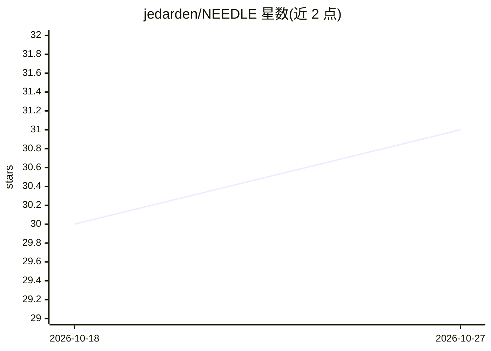

# jedarden/NEEDLE

⭐ 31 · Rust · MIT · 推送 2026-10-25 · [GitHub](https://github.com/jedarden/NEEDLE) · [官网](https://jedarden.com/projects/needle/) · 个人维护

**面向无头编码 CLI agent 的确定性队列编排器**

用 Rust 编写的无头 agent 编排器：以状态机驱动非确定性 agent，从共享 bead 队列按确定优先级原子认领工作项，分发到内置适配的 CLI agent（Claude Code、OpenCode、Codex、Aider），并对成功/失败/超时/崩溃等每种退出结果走显式处理路径。多 worker 可并行，靠 SQLite 队列协调，无中心编排器。附带已交付工作门禁与验证门禁回退机制。需 git、tmux 与 agent CLI；预编译二进制仅 Linux x86_64，其余从源码构建。

## 筛选速览

| 维度 | 判定 | 备注 |
|---|---|---|
| AI 角色 | `ai-ecosystem` | LLM/agent 周边工具 |
| 许可风险 | `permissive` | MIT |
| 部署形态 | `library` | 以包/库形式分发 |
| 模型依赖 | locked-api |  |
| 硬件要求 | — | 无带数字的原话,不猜 |
| 安装摩擦 | `low` | 无编译、无系统依赖或容器化 |
| 成熟度 | — | 结构信号不足 |

## 能力要点

- 确定性状态机驱动 agent，每种退出码有显式处理器
- 内置 Claude Code / OpenCode / Codex / Aider 四种 CLI 适配器
- SQLite 原子认领支持多 worker 并行、无中心编排
- shipped-work 门禁与按项目类型自动选择的验证门禁回退

## 适用场景

- 无人值守地让编码 agent 批量消化结构化任务队列
- 多 worker 并行处理同一工作区的任务并自动验证产出
- 对长时运行、成本受限的 agent 工作做结果分类与路由

## 场景标签

`Agent 框架` · 领域:Agent 开发

## 证据(README 行号)

> L14: NEEDLE is a wrapper for headless coding CLI agents. It processes a shared bead queue in deterministic order, dispat

## 星数曲线

2026-10-18 30 → 2026-10-27 31（+1）

---
*卡片 v1 · prompt 1.4 · 生成 2026-10-26 · 置信度 mid · 依据 README sha `e6612ba9eacb` · [字段定义](../../DATASET.md)*
