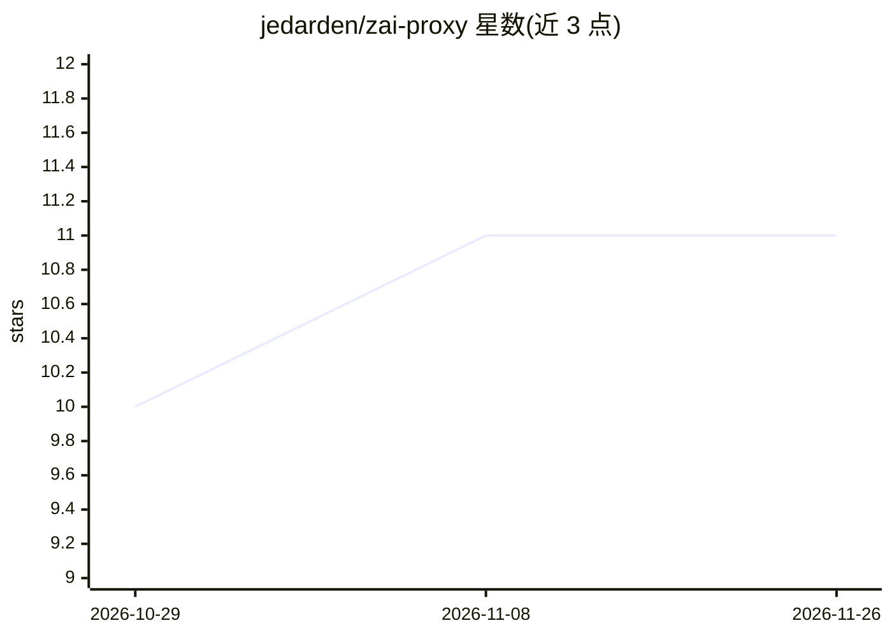

# jedarden/zai-proxy

⭐ 11 · Go · MIT · 推送 2026-11-01 · [GitHub](https://github.com/jedarden/zai-proxy) · [官网](https://jedarden.com) · 个人维护

**为 Z.AI Claude API 提供代理、限流与指标看板**

用 Go 编写的 HTTP 反向代理，部署在 Z.AI Claude API 之前，提供令牌计数（API 上报用量优先、tiktoken 估算兜底）、基于 EWMA 的自适应限流、Prometheus 指标导出、蓝绿/金丝雀部署打标以及 SSE 流式透传。附带 Go 后端加 React 前端的实时监控看板，每 5 秒抓取代理指标并通过 SSE 推送到浏览器，支持按模型与部署变体分面展示吞吐、延迟、令牌与错误数据。

## 筛选速览

| 维度 | 判定 | 备注 |
|---|---|---|
| AI 角色 | `ai-ecosystem` | LLM/agent 周边工具 |
| 许可风险 | `permissive` | MIT |
| 部署形态 | `None` |  |
| 模型依赖 | — | README 未给出锁定关系 |
| 硬件要求 | — | 无带数字的原话,不猜 |
| 安装摩擦 | `low` | 无编译、无系统依赖或容器化 |
| 成熟度 | — | 结构信号不足 |

## 能力要点

- 自适应限流：EWMA 估算上限并在限值下方保持，周期性探测上限变化
- 令牌计数含 input/output/cache_read/cache_write 方向与定价层级标签
- 蓝绿/金丝雀支持：按 DEPLOYMENT_VARIANT 在同一指标命名空间对比
- 限流上限状态可持久化到文件，重启后可恢复

## 适用场景

- 为团队共享的 LLM API 出口补充可观测性与限流能力
- 灰度发布时对比不同代理版本或模型配置的表现
- 监控各模型的令牌消耗、延迟百分位与错误率

## 场景标签

`LLM 可观测性` · 领域:评测与运维

## 证据(README 行号)

> L3: Production-grade LLM reverse proxy with token counting, adaptive rate limiting, and a real-time metrics dashboard.
> L19: Go HTTP reverse proxy. Listens on `:8080`, forwards to the upstream LLM API, and exports Prometheus metrics at `/me
> L25: Go backend + React frontend for live monitoring. Scrapes the proxy's Prometheus endpoint every 5 seconds, keeps dua

## 星数曲线

2026-10-29 10 → 2026-11-26 11（+1）

---
*卡片 v1 · prompt 1.4 · 生成 2026-11-18 · 置信度 high · 依据 README sha `c5a322997748` · [字段定义](../../DATASET.md)*
