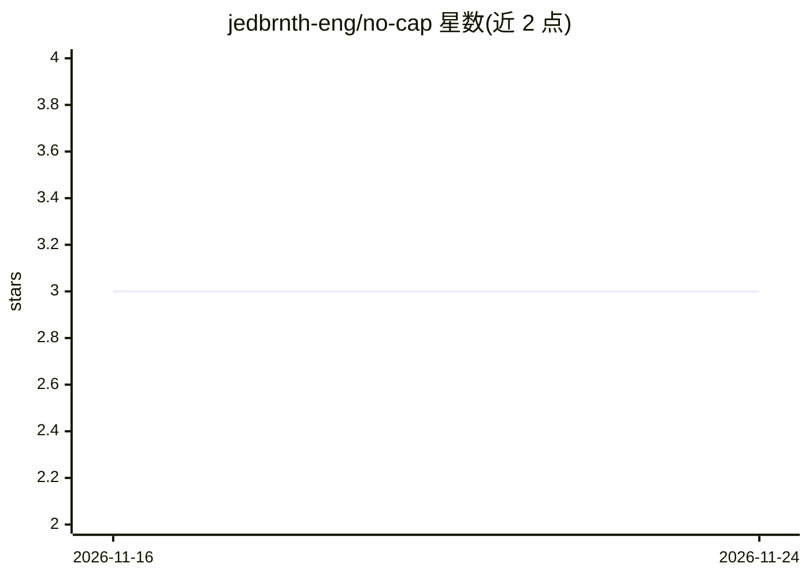

# jedbrnth-eng/no-cap

⭐ — · [GitHub]() · 个人维护

**核验 agent 回复与工具实际返回是否一致、标记不实声明的插件**

Hermes Agent 的插件：通过 post_tool_call 钩子记录每次工具调用的真实结果（退出码、测试摘要、push ref、PR 状态等，每条≤160字符），在最终回复中对测试、CI、构建、推送、合并、部署等声明逐条判定，追加 🧾 NO CAP / 🧢 CAP / 🤔 NO RECEIPT 脚注。纯 Python 实现，无额外模型、无网络调用；钩子失败时回复原样发出。含 strict 模式的 pre_verify 停止门、/cap 重验命令、/capscore 诚实度看板，以及可选的 Obsidian 错误笔记桥接。README 同时列出未通过的负结果（如 🧾 不等于修复正确）。

## 筛选速览

| 维度 | 判定 | 备注 |
|---|---|---|
| AI 角色 | `ai-ecosystem` | LLM/agent 周边工具 |
| 许可风险 | `permissive` | — |
| 部署形态 | `None` |  |
| 模型依赖 | — | README 未给出锁定关系 |
| 硬件要求 | — | 无带数字的原话,不猜 |
| 安装摩擦 | `low` | 无编译、无系统依赖或容器化 |
| 成熟度 | — | 结构信号不足 |

## 能力要点

- 从真实工具结果（非模型文本）填充账本，确定性判定，同输入同结论
- 无第二模型、无 token、无网络，Apache-2.0 许可
- strict 模式用 pre_verify 停止门拦截未证明的声明（最多 2 次回推）
- 检测测试套件篡改（skip/删除失败用例后声称全过）

## 适用场景

- 本地运行 agent 写代码后核验其“所有测试通过”类声明
- 对 agent 的 push/merge/deploy 声明做只读复查（/cap）
- 在 Obsidian 中按 agent 归档其 CAP 记录并生成错误看板

## 场景标签

 · 领域:LLM 基础设施/agent 可靠性

## 证据(README 行号)

> L5:  A Hermes Agent plugin. It records what every tool call
> L87: |`transform_llm_output`|Finds the claims in the final reply (tests, CI, build, pushed, merged, committed, PR, deplo
> L103: - **Deterministic and cheap.** Plain Python on hook data: no second model, no tokens, no network. Same verdict for

## 星数曲线

2026-11-16 3 → 2026-11-24 3（+0）

---
*卡片 v1 · prompt 1.4 · 生成 2026-11-21 · 置信度 high · 依据 README sha `689693b74c21` · [字段定义](../../DATASET.md)*
