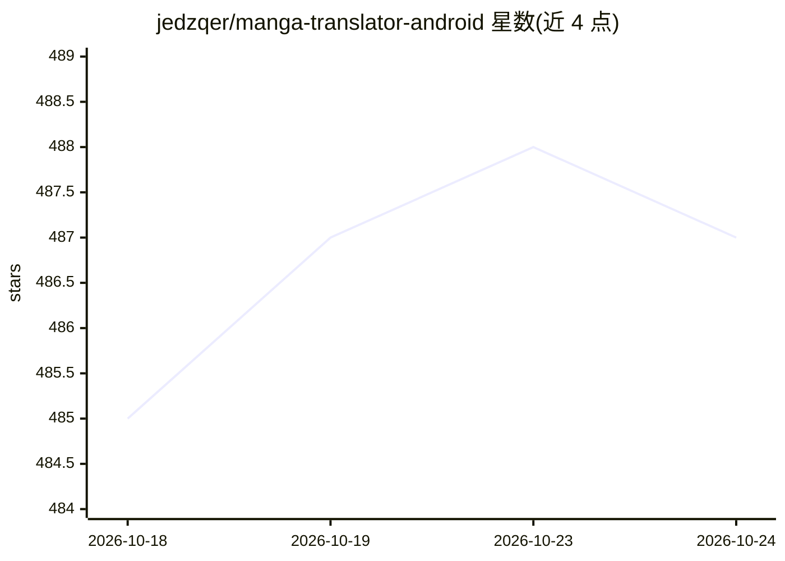

# jedzqer/manga-translator-android

⭐ 487 · Kotlin · MIT · 推送 2026-10-20 · [GitHub](https://github.com/jedzqer/manga-translator-android) · 个人维护 · 中文 README

**安卓端 LLM 驱动的漫画自动翻译与阅读 App**

面向安卓用户的漫画翻译应用：本地气泡检测与 OCR（YOLO 分割 + PaddleOCR 多语言识别），通过 OpenAI 兼容 API 调用 LLM 完成翻译，在原图上覆盖显示可拖动的翻译气泡；另支持悬浮窗屏幕翻译，可在任意界面识别翻译屏幕文本。内置漫画库管理（CBZ/ZIP/PDF 导入导出）、按文件夹的 glossary.json 译名表、条漫跨页气泡合并等阅读功能。需自备 OpenAI 兼容 API 地址与 Key，从源码构建需 JDK 17 与 Android SDK，模型文件放入 assets 目录。

## 筛选速览

| 维度 | 判定 | 备注 |
|---|---|---|
| AI 角色 | `ai-native` | 本体是模型或模型工具 |
| 许可风险 | `permissive` | MIT |
| 部署形态 | `None` |  |
| 模型依赖 | — | README 未给出锁定关系 |
| 硬件要求 | — | 无带数字的原话,不猜 |
| 安装摩擦 | `medium` | 含编译或系统依赖之一 |
| 成熟度 | — | 结构信号不足 |

## 能力要点

- 气泡检测 + 本地/OpenAI 兼容 OCR + LLM 翻译流水线
- 悬浮窗屏幕翻译，可在任意 App 或桌面识别翻译
- 支持日英韩法西葡德意俄等多源语言，目标语言随界面语言
- 按文件夹维护 glossary.json 自动累积译名；条漫跨页气泡合并

## 适用场景

- 在手机上导入漫画并一键翻译成中文阅读
- 阅读外文漫画时用悬浮窗即时翻译屏幕文本
- 用自有 OpenAI 兼容 API（如 DeepSeek）翻译漫画并维护译名表

## 场景标签

`OCR` · 领域:感知与多模态

## 证据(README 行号)

> L5: 面向安卓的漫画翻译 App：本地气泡检测与 OCR，结合 OpenAI 兼容接口完成翻译，并在原图上覆盖显示可拖动的翻译气泡。并支持屏幕翻译/悬浮窗翻译，可在任意 App 或桌面上直接识别并翻译当前屏幕中的漫画文本。
> L17: - 翻译流程：气泡检测 + 本地或 OpenAI 兼容 API OCR + LLM 翻译，支持标准模式与全文速译

## 星数曲线

2026-10-18 485 → 2026-10-24 487（+2）

---
*卡片 v1 · prompt 1.4 · 生成 2026-10-22 · 置信度 high · 依据 README sha `65a22c5d20ef` · [字段定义](../../DATASET.md)*
