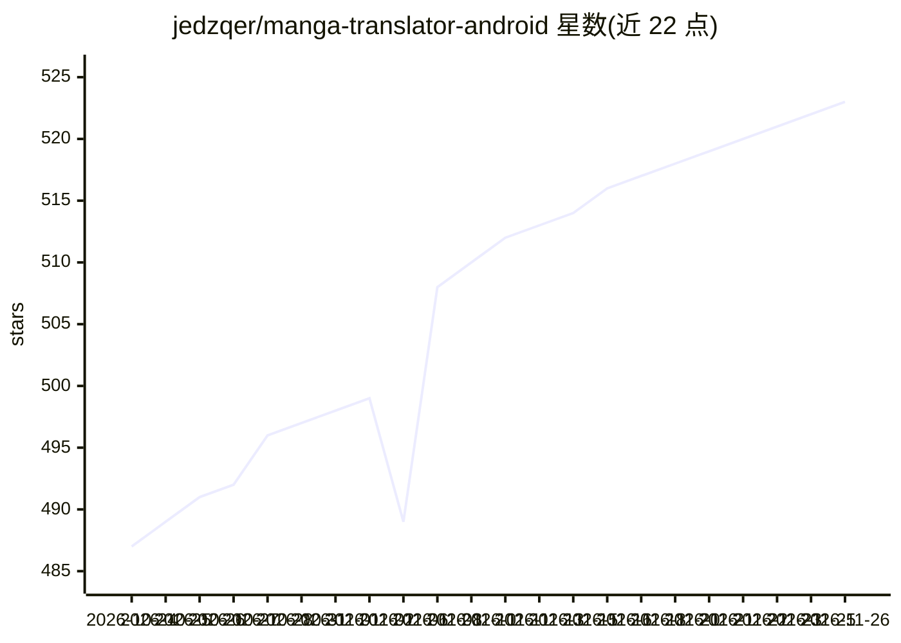

# jedzqer/manga-translator-android

⭐ 523 · Kotlin · NOASSERTION · 推送 2026-11-25 · [GitHub](https://github.com/jedzqer/manga-translator-android) · 个人维护 · 中文 README

**给安卓用户的 LLM 驱动漫画即时翻译与阅读应用**

Android 平台的漫画翻译与阅读应用：自动检测气泡与游离文字，提供本地 OCR、API OCR、低置信度 AI OCR 补充、VL 视觉直译与全文速译五种翻译方式，译文覆盖回原图。翻译 API 需用户自备，支持 OpenAI 兼容 Chat、OpenAI Responses 与 Gemini 接口配置。附带漫画库管理、条漫阅读、跨页上下文译名表、悬浮窗跨应用翻译、备份导出。本地分割模型随仓库分发，OCR 模型需自行下载。提供 APK 下载，也可从源码构建（需 JDK 17 与 Android SDK）。

## 筛选速览

| 维度 | 判定 | 备注 |
|---|---|---|
| AI 角色 | `ai-native` | 本体是模型或模型工具 |
| 许可风险 | `none` | NOASSERTION |
| 部署形态 | `None` |  |
| 模型依赖 | — | README 未给出锁定关系 |
| 硬件要求 | — | 无带数字的原话,不猜 |
| 安装摩擦 | `medium` | 含编译或系统依赖之一 |
| 成熟度 | — | 结构信号不足 |

## 能力要点

- 五种翻译方式：本地 OCR、API OCR、AI OCR 补充、VL 直译、全文速译
- 支持 OpenAI 兼容 Chat、OpenAI Responses 与 Gemini 三种接口格式
- 悬浮窗截屏翻译与半透明穿透模式
- 随仓库分发基于 YOLO26s-seg 的 TFLite 分割模型

## 适用场景

- 批量翻译本地漫画文件夹并生成可阅读的译文版
- 阅读条漫时滚动获取连续剧情上下文的翻译
- 在其他应用中通过悬浮球截屏翻译屏幕上的漫画
- 从 CBZ/ZIP/PDF 导入漫画并按文件夹设置源语言与文风

## 场景标签

`OCR` `图像视频处理` `多模态` · 领域:感知与多模态

## 证据(README 行号)

> L5: 面向 Android 的漫画翻译与阅读 App。自动检测气泡和游离文字，使用本地 OCR 或云端 OCR 配合 AI 翻译，也可直接交给视觉模型翻译，再将译文覆盖到原图上。支持漫画库批量处理、条漫阅读和跨应用悬浮窗翻译。
> L25: - **AI 配置**：支持 OpenAI 兼容 Chat、OpenAI Responses 和 Gemini 接口，保存及切换供应商配置，自定义请求参数、提示词与翻译文风；文件夹或集合可单独设置文风。

## 星数曲线

2026-10-24 487 → 2026-11-26 523（+36）

---
*卡片 v1 · prompt 1.4 · 生成 2026-11-25 · 置信度 high · 依据 README sha `5dd645a89166` · [字段定义](../../DATASET.md)*
