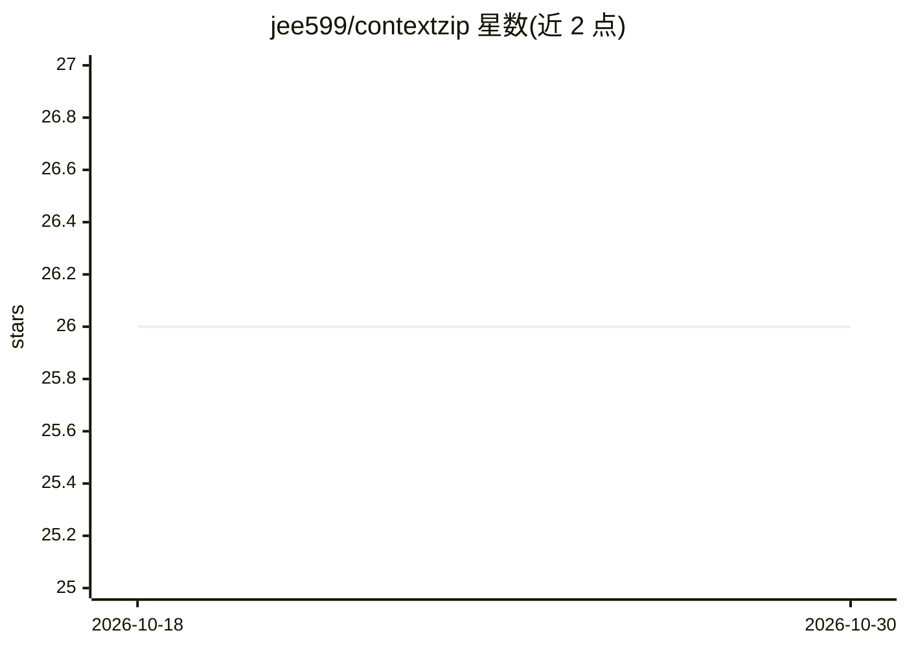

# jee599/contextzip

⭐ 26 · Rust · NOASSERTION · 推送 2026-06-03 · [GitHub](https://github.com/jee599/contextzip) · 个人维护 · 中文 README

**压缩 CLI 输出以节省 AI 编程助手上下文的 Rust 工具**

面向 Claude Code / Cursor / Copilot CLI 用户的输出压缩 CLI：通过 hook 拦截命令输出，压缩错误堆栈、构建日志、npm 安装、Docker 构建、网页内容与 ANSI 噪声等，102 项测试平均节省 61%（40-97%，部分场景为负）。错误信息、file:line、安全告警与退出码始终保留；不确定内容直接透传。v0.2 增加对 ~/.claude/projects/ 会话 JSONL 历史的 compact/apply/expand 可逆压缩。基于 RTK fork，Rust 编写，含 1,112 个测试，收集匿名遥测且可禁用。

## 筛选速览

| 维度 | 判定 | 备注 |
|---|---|---|
| AI 角色 | `ai-ecosystem` | LLM/agent 周边工具 |
| 许可风险 | `none` | NOASSERTION |
| 部署形态 | `self-host` | docker 或自建部署 |
| 模型依赖 | — | README 未给出锁定关系 |
| 硬件要求 | — | 无带数字的原话,不猜 |
| 安装摩擦 | `low` | 无编译、无系统依赖或容器化 |
| 成熟度 | — | 结构信号不足 |

## 能力要点

- hook 自动拦截压缩 stdout，102 项测试平均节省 61%
- v0.2 会话历史压缩（compact/apply/expand 可逆，保留 .bak 回滚）
- 错误信息、file:line、CVE 告警、退出码始终保留
- contextzip gain 查看累计节省统计

## 适用场景

- Claude Code / Cursor 等工具频繁触顶 token 上限时压缩命令输出
- 需要原始输出时用 contextzip proxy 绕过压缩
- 压缩累积的 Claude Code 会话 JSONL 历史文件

## 场景标签

 · 领域:开发者工具/AI 编程助手配套

## 证据(README 行号)

> L3:  CLI output eats your AI context window. ContextZip compresses it 40-97% (61% avg across 102 tests).
> L10:  For: Claude Code / Cursor / Copilot CLI users hitting token limits.
> L41: Restart Claude Code. Every command is now compressed. Zero config.

## 星数曲线

2026-10-18 26 → 2026-10-30 26（+0）

---
*卡片 v1 · prompt 1.4 · 生成 2026-10-26 · 置信度 mid · 依据 README sha `2936d7b0c8c3` · [字段定义](../../DATASET.md)*
