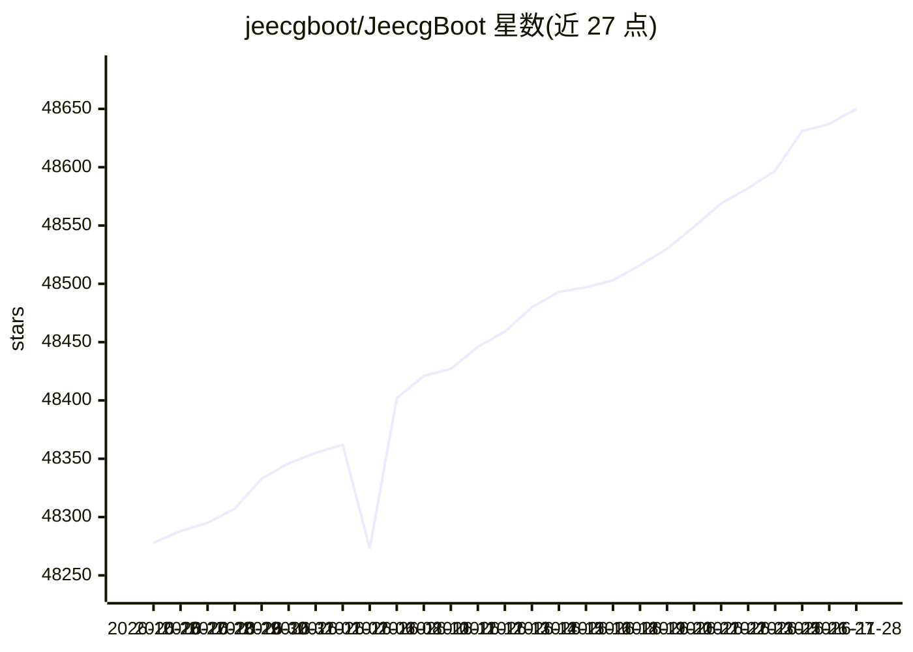

# jeecgboot/JeecgBoot

⭐ 48,650 · Java · Apache-2.0 · 推送 2026-11-11 · [GitHub](https://github.com/jeecgboot/JeecgBoot) · [官网](https://jeecg.com) · 组织维护 · 中文 README

**面向企业开发者的 AI 低代码平台，一句话生成业务系统基座**

前后端分离的低代码开发平台（Spring Boot 4 + Vue3），内置权限、多租户、工作流（Flowable）、报表（JimuReport）、大屏（JimuBI）等企业级模块。AI 部分：Skills 自然语言编程可生成建表 SQL、前后端代码、菜单权限、BPMN 流程、表单、报表与大屏；内置类似 Dify 的 AI 应用平台，提供聊天助手、知识库（RAG）、流程编排、MCP 与模型管理，后端 AI 框架为 langchain4j。Apache-2.0 协议，支持单体与微服务部署，默认仅提供 MySQL 脚本，其他数据库需自行转换。

## 筛选速览

| 维度 | 判定 | 备注 |
|---|---|---|
| AI 角色 | `ai-enhanced` | 去掉 AI 部分产品仍成立 |
| 许可风险 | `permissive` | Apache-2.0 |
| 部署形态 | `None` |  |
| 模型依赖 | local-ok | 支持本地模型 |
| 硬件要求 | — | 无带数字的原话,不猜 |
| 安装摩擦 | `medium` | 含编译或系统依赖之一 |
| 成熟度 | — | 结构信号不足 |

## 动量与使用信号

- 维护:`active` — 距上次 push 4.2 天,年发版 5,29 位贡献者
- 涨星:近 1 天 **+11**(自 20261016 起算)
- 平台:LINUX · 协议:MCP / OLLAMA

## 能力要点

- 一句话生成完整业务模块：建表、前后端代码、菜单权限自动产出
- 内置 AI 应用平台：聊天、知识库 RAG、流程编排、MCP、插件
- 封装 jeecg-codegen/jeecg-bpmn 等 Skills，配合 Claude Code 驱动开发流程
- 兼容 MySQL、Oracle、PG、达梦、人大金仓、TiDB 等多种数据库

## 适用场景

- 搭建 OA、ERP、CRM、MES 等权限流程复杂的企业系统
- 在企业业务系统中集成 AI 知识库与 AI 助手
- 通过自然语言生成 BPM 流程、表单、报表和大屏
- 需要 SaaS 多租户与信创国产化适配的项目

## 场景标签

`RAG` `代码生成` · 领域:编码与开发

## 证据(README 行号)

> L14: > **JeecgBoot 是一款免费开源的 AI 低代码平台（Apache-2.0 协议，个人和企业均可免费商用），也是 AI 时代构建复杂业务系统的开源基座。**
> L21: JeecgBoot 是一款**免费开源**的 AI 低代码开发平台，以 **低代码开发、AI 应用平台和 AI 知识库** 为核心能力。随着 AI Skills 自然语言编程的发布，平台迈入低代码 v2.0：开发者可用一句话生成完
> L179: JeecgBoot平台提供了一套完善的AI应用管理系统模块，是一套类似`Dify`的`AIGC应用开发平台`+`知识库问答`，是一款基于LLM大语言模型AI应用平台和 RAG 的知识库问答系统。

## 星数曲线

2026-10-26 48,278 → 2026-11-28 48,650（+372）

---
*卡片 v1 · prompt 1.4 · 生成 2026-11-22 · 置信度 high · 依据 README sha `2fd601744425` · [字段定义](../../DATASET.md)*
