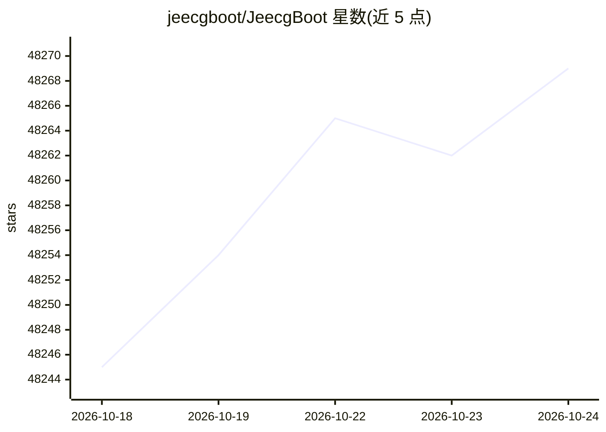

# jeecgboot/JeecgBoot

⭐ 48,269 · Java · Apache-2.0 · 推送 2026-10-23 · [GitHub](https://github.com/jeecgboot/JeecgBoot) · [官网](https://jeecg.com) · 组织维护 · 中文 README

**企业级 AI 低代码平台：一句话生成前后端系统**

基于 Spring Boot 与 Vue3 前后端分离架构的 AI 低代码开发平台，核心能力为低代码开发、AI 应用平台与 AI 知识库。AI Skills 结合 Claude Code 支持自然语言生成代码、表单、流程、报表与大屏；内置 AI 聊天、知识库（RAG）、流程编排、MCP 插件等模块。代码生成器支持单表、树表、一对一/一对多模型，兼容 MySQL、Oracle、PostgreSQL、达梦、人大金仓等多种数据库，支持单体与微服务部署。默认账号 admin/123456，提供 IDEA 与 Docker 启动方式。

## 筛选速览

| 维度 | 判定 | 备注 |
|---|---|---|
| AI 角色 | `ai-native` | 本体是模型或模型工具 |
| 许可风险 | `permissive` | Apache-2.0 |
| 部署形态 | `None` |  |
| 模型依赖 | local-ok | 支持本地模型 |
| 硬件要求 | — | 无带数字的原话,不猜 |
| 安装摩擦 | `medium` | 含编译或系统依赖之一 |
| 成熟度 | — | 结构信号不足 |

## 动量与使用信号

- 维护:`active` — 距上次 push 4.2 天,年发版 5,29 位贡献者
- 涨星:近 1 天 **+11**(自 20261016 起算)
- 平台:LINUX · 协议:MCP / OLLAMA

## 能力要点

- 一句话生成完整系统：AI 自动建表、生成前后端 CRUD 代码与菜单权限
- AI 应用平台：聊天助手、知识库（RAG）、流程编排、MCP 与插件管理
- 兼容多种主流大模型（ChatGPT、DeepSeek、Ollama、千问、智普、minimax 等）
- 支持单体/微服务切换，兼容 MySQL、Oracle、达梦、人大金仓等多种数据库

## 适用场景

- 快速搭建 MIS、OA、ERP、CRM 等企业信息管理系统
- 构建企业内部 AI 知识库问答系统
- 低代码生成前后端代码并保留源码级扩展
- 搭建 SaaS 多租户业务平台

## 场景标签

`代码生成` `工作流自动化` `文档问答` · 领域:效率与自动化

## 证据(README 行号)

> L17: JeecgBoot 是一款 AI 低代码开发平台，以 **低代码开发、AI 应用平台和 AI 知识库** 为核心能力。随着 AI Skills 自然语言编程的发布，平台迈入低代码 v2.0：开发者可用一句话生成完整系统或业务模块，
> L167: - AI框架：langchain4j 1.17.2，AI模型支持 `ChatGPT` `DeepSeek` `千问` `智普` `minimax`、`本地模型`等

## 星数曲线

2026-10-18 48,245 → 2026-10-24 48,269（+24）

---
*卡片 v1 · prompt 1.4 · 生成 2026-10-18 · 置信度 high · 依据 README sha `4b144274dab8` · [字段定义](../../DATASET.md)*
