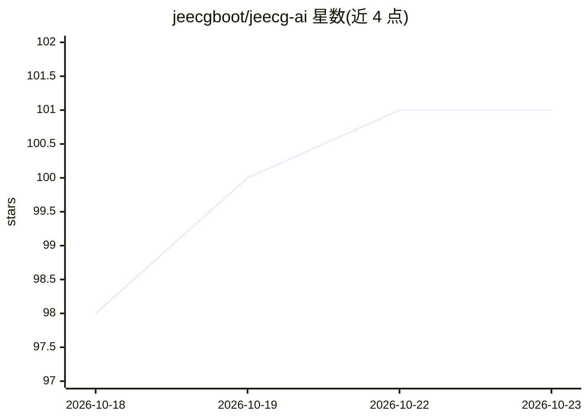

# jeecgboot/jeecg-ai

⭐ 101 · Java · Apache-2.0 · 推送 2026-03-20 · [GitHub](https://github.com/jeecgboot/jeecg-ai) · [官网](https://jeecg.com/aigcIndex) · 组织维护 · 中文 README

**面向企业的 AI 应用平台 + 零代码搭建平台（Java/Vue3）**

基于 JeecgBoot 精简的独立项目，定位为类似 Dify 的 AIGC 应用平台与零代码应用搭建结合体。功能包括 AI 知识库、AI 流程编排（画布式设计器，含知识库/AI/分支/脚本等节点）、大模型管理、Chat2BI 报表、AI 大屏与 Online 表单。底层使用 langchain4j，支持对接 DeepSeek、ChatGPT、通义千问、Ollama 本地模型等；技术栈为 Spring Boot 3 + Vue3，需要 JDK17、MySQL、Redis、pgvector 向量库。支持 Docker 一键启动与 Iframe 嵌入第三方系统。

## 筛选速览

| 维度 | 判定 | 备注 |
|---|---|---|
| AI 角色 | `ai-ecosystem` | LLM/agent 周边工具 |
| 许可风险 | `permissive` | Apache-2.0 |
| 部署形态 | `None` |  |
| 模型依赖 | local-ok | 支持本地模型 |
| 硬件要求 | — | 无带数字的原话,不猜 |
| 安装摩擦 | `medium` | 含编译或系统依赖之一 |
| 成熟度 | — | 结构信号不足 |

## 能力要点

- 画布式 AI 流程编排（知识库/AI/分支/JAVA/脚本等节点）与实时运行查看
- RAG 知识库：支持 PDF/PPT/Markdown 文档导入与问答对训练
- 多模型对接：DeepSeek/ChatGPT/通义千问/Ollama 本地模型等
- AI 流程可发布为功能性 API，聊天应用可 Iframe 嵌入第三方系统

## 适用场景

- 企业搭建基于自有文档的 AI 知识库问答系统
- 通过 AI 流程编排生成翻译接口、聊天机器人等智能体 API
- 零代码搭建业务系统并结合 Chat2BI 报表与 AI 大屏

## 场景标签

`Agent 框架` `聊天机器人` `文档问答` `RAG` · 领域:Agent 开发

## 证据(README 行号)

> L12: Jeecg-AI 是一套类似`Dify`的`AIGC应用平台`+`知识库问答`+`零代码应用搭建`，是一款基于大型语言模型和RAG技术的AI应用平台与零代码应用搭建平台，重点提供图文并茂的AI知识库和智能聊天功能，界面直观，支持知
> L29: > Jeecg-AI 是基于 JeecgBoot 精简而来的独立项目，专注于 AI 应用场景。

## 星数曲线

2026-10-18 98 → 2026-10-23 101（+3）

---
*卡片 v1 · prompt 1.4 · 生成 2026-10-23 · 置信度 high · 依据 README sha `2af91a52d8a4` · [字段定义](../../DATASET.md)*
