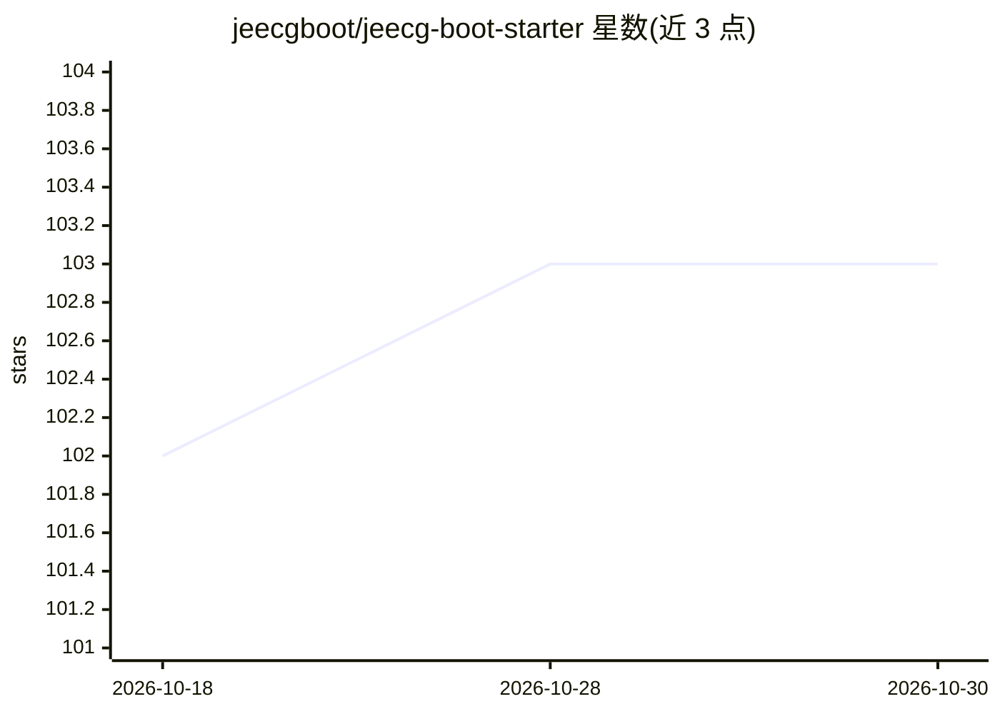

# jeecgboot/jeecg-boot-starter

⭐ 103 · Java · Apache-2.0 · 推送 2026-10-23 · [GitHub](https://github.com/jeecgboot/jeecg-boot-starter) · [官网](http://www.jeecg.com) · 组织维护 · 中文 README

**JeecgBoot 低代码平台的企业级 Spring Boot starter 模块集合**

JeecgBoot 低代码平台的核心启动器模块集合，基于 Spring Boot 4 与 JDK 17，将各类技术组件拆分为独立 starter：微服务（Spring Cloud Alibaba）、Sentinel 限流、Seata 分布式事务、Redisson 分布式锁、XXL-Job 调度、RabbitMQ/RocketMQ 消息队列、ShardingSphere 分库分表、MongoDB，以及基于 LangChain4j 的 AI 集成 starter（支持 OpenAI、Ollama、通义千问、文心一言、智谱 AI、Anthropic 等）。面向使用 JeecgBoot 的 Java 开发者，通过 Maven 依赖按需引入，自动配置。

## 筛选速览

| 维度 | 判定 | 备注 |
|---|---|---|
| AI 角色 | `ai-ecosystem` | LLM/agent 周边工具 |
| 许可风险 | `permissive` | Apache-2.0 |
| 部署形态 | `None` |  |
| 模型依赖 | local-ok | 支持本地模型 |
| 硬件要求 | — | 无带数字的原话,不猜 |
| 安装摩擦 | `medium` | 含编译或系统依赖之一 |
| 成熟度 | — | 结构信号不足 |

## 能力要点

- 覆盖微服务、分布式事务/锁、消息队列、分库分表等企业组件的模块化 starter
- 基于 LangChain4j 的 AI 集成模块，支持 OpenAI、Ollama、通义千问、Anthropic 等多种大模型
- 基于 Spring Boot 4 与 JDK 17，引入依赖后自动配置

## 适用场景

- JeecgBoot 项目按需引入微服务、消息队列、分库分表等企业组件
- Java 项目统一集成多家大模型 API
- 微服务架构下引入限流、分布式事务与任务调度组件

## 场景标签

`模型网关` · 领域:Agent 开发

## 证据(README 行号)

> L6: > jeecg-boot-starter 是 JeecgBoot 低代码平台的核心启动器模块集合，基于 Spring Boot 4 和 JDK 17 构建。
> L43:     ├── jeecg-boot-starter-ai          -- AI集成starter（LangChain4j）
> L73: - **jeecg-boot-starter-ai**：基于LangChain4j的AI集成模块，支持OpenAI、Ollama、通义千问、文心一言、智谱AI、Anthropic等多种大模型

## 星数曲线

2026-10-18 102 → 2026-10-30 103（+1）

---
*卡片 v1 · prompt 1.4 · 生成 2026-10-23 · 置信度 high · 依据 README sha `818a3b5da87e` · [字段定义](../../DATASET.md)*
