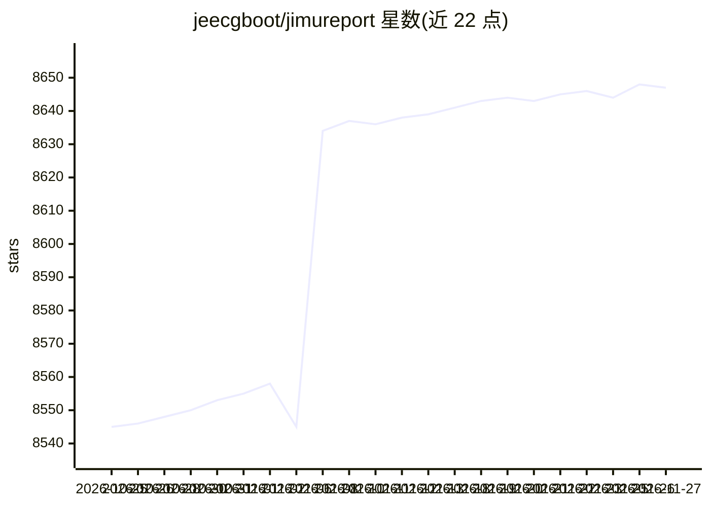

# jeecgboot/jimureport

⭐ 8,647 · Java · GPL-3.0 · 推送 2026-11-11 · [GitHub](https://github.com/jeecgboot/jimureport) · [官网](http://jimureport.com) · 组织维护 · 中文 README

**给企业做可视化报表/大屏/BI 的开源工具，AI 一句话生成报表**

积木报表是免费可商用的报表与 BI 工具，集成 SpringBoot 项目使用，覆盖报表设计、数据大屏、仪表盘、打印、数据填报。通过 Maven starter 引入（报表/BI/ChatBI 三个模块），需 JDK17+ 与 MySQL 初始化脚本。AI 部分：设计器内置 AI 助手，配置兼容 OpenAI Chat Completions API 的服务商后，一句话或截图生成报表、大屏、仪表盘；JimuChatBI 对话式问数；另提供 Claude Code 技能包。代码不开放，商业去版权需授权。

## 筛选速览

| 维度 | 判定 | 备注 |
|---|---|---|
| AI 角色 | `ai-enhanced` | 去掉 AI 部分产品仍成立 |
| 许可风险 | `dual` | GPL-3.0 |
| 部署形态 | `None` |  |
| 模型依赖 | locked-api |  |
| 硬件要求 | — | 无带数字的原话,不猜 |
| 安装摩擦 | `medium` | 含编译或系统依赖之一 |
| 成熟度 | — | 结构信号不足 |

## 能力要点

- AI 助手：一句话描述或上传截图生成报表/大屏/仪表盘，支持对话式修改
- JimuChatBI 对话式智能问数，自然语言生成表格与图表
- 兼容 30+ 数据源，适配达梦、人大金仓等信创国产数据库
- 提供 Claude Code 技能包（jimureport/jimubi-bigscreen/jimubi-dashboard）

## 适用场景

- 给 SpringBoot 业务系统集成报表与打印填报能力
- 不写 SQL，用对话方式做数据分析与看板
- 信创环境下的国产化报表替代方案

## 场景标签

`数据分析` · 领域:效率与自动化

## 证据(README 行号)

> L14: 积木报表是一款**免费开源的报表与 BI 工具**，集可视化报表设计、数据大屏、仪表盘、打印设计、数据填报和 Chat2BI 智能问数于一体，功能免费、可商用，可作为帆软、润乾报表的免费替代。
> L18: - **🤖 AI 助手**：设计器内置 AI 入口，配置即用。一句话描述需求或上传截图，自动生成报表、大屏、仪表盘；不满意就接着说，AI 持续修改优化。

## 星数曲线

2026-10-25 8,545 → 2026-11-27 8,647（+102）

---
*卡片 v1 · prompt 1.4 · 生成 2026-11-22 · 置信度 high · 依据 README sha `d6e668eaf2f5` · [字段定义](../../DATASET.md)*
