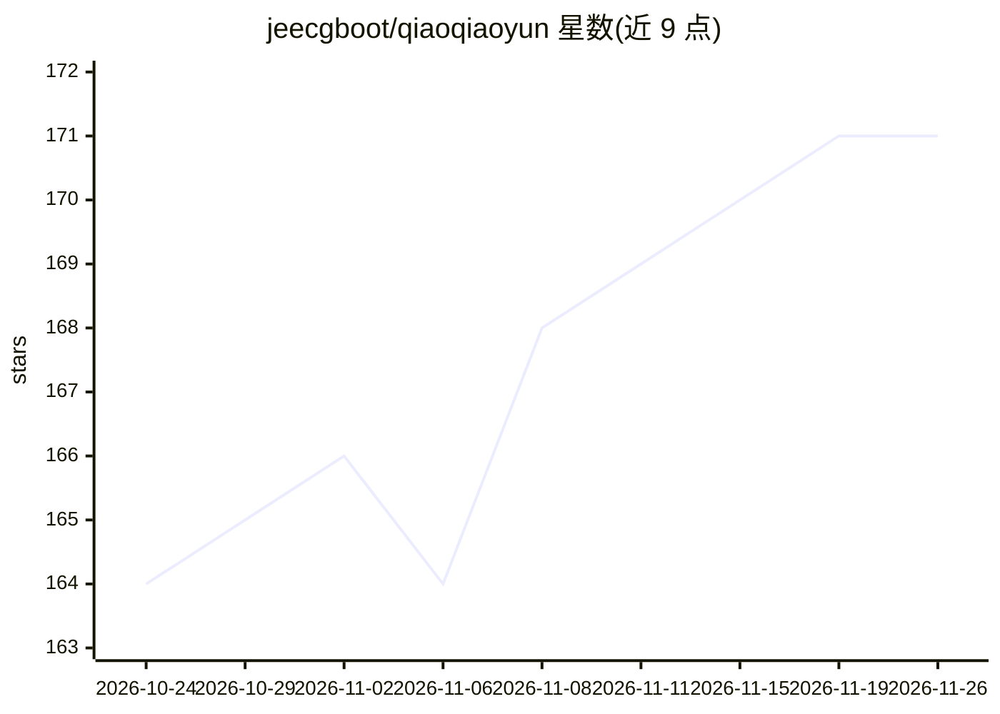

# jeecgboot/qiaoqiaoyun

⭐ 171 · Java · NOASSERTION · 推送 2026-11-10 · [GitHub](https://github.com/jeecgboot/qiaoqiaoyun) · [官网](https://www.qiaoqiaoyun.com) · 组织维护 · 中文 README

**企业零代码搭建业务系统的平台，集成 AI 建表与知识库**

面向企业的零代码应用搭建平台，提供表单引擎、流程引擎、仪表盘设计、大屏报表与应用模板等功能模块，支持通过拖拽方式搭建 CRM、进销存、OA 等业务系统。AI 方面集成了 ChatGPT、DeepSeek 等大模型，支持 AI 建表、智能问答与一句话生成应用（基于 Claude Code Skills）。支持私有化部署，README 声明功能免费、可商用、代码不开放。提供脚本一键安装、Docker 部署与手动部署三种方式。

## 筛选速览

| 维度 | 判定 | 备注 |
|---|---|---|
| AI 角色 | `ai-enhanced` | 去掉 AI 部分产品仍成立 |
| 许可风险 | `none` | NOASSERTION |
| 部署形态 | `self-host` | docker 或自建部署 |
| 模型依赖 | — | README 未给出锁定关系 |
| 硬件要求 | — | 无带数字的原话,不猜 |
| 安装摩擦 | `low` | 无编译、无系统依赖或容器化 |
| 成熟度 | — | 结构信号不足 |

## 能力要点

- 拖拽式表单/流程/仪表盘设计，40+ 表单控件、25 种流程节点
- 集成 ChatGPT、DeepSeek 大模型，支持 AI 建表与智能问答
- 官方提供 Claude Code Skills，终端一句话搭建应用/工作表/仪表盘
- 支持 Linux/macOS 脚本一键安装、Docker Compose 部署与手动部署

## 适用场景

- 快速搭建 CRM、进销存、OA 等企业内部业务系统
- 替代 Excel 做工单管理、客户登记、问卷数据采集
- 私有化部署企业应用平台并接入大模型问答
- 无编程基础的教学演示与毕业设计原型搭建

## 场景标签

`工作流自动化` `知识库管理` · 领域:效率与自动化

## 证据(README 行号)

> L10: 敲敲云是一款 **完全免费** 的零代码应用搭建平台，助力企业快速搭建业务系统和构建AI应用。用户无需编码，即可快速拖拽出复杂业务系统，5分钟可搭建一套CRM系统！她集成了**零代码应用**、**AI应用平台**和**AI知识库*
> L142: - **🤖 AI智能赋能**：集成 ChatGPT、DeepSeek 等主流大模型，支持 AI 建表、智能问答、工作流编排
> L157: |✅ 零代码门槛|拖拽即可完成复杂业务系统搭建|

## 星数曲线

2026-10-24 164 → 2026-11-26 171（+7）

---
*卡片 v1 · prompt 1.4 · 生成 2026-11-26 · 置信度 high · 依据 README sha `aa9bf56a3f63` · [字段定义](../../DATASET.md)*
