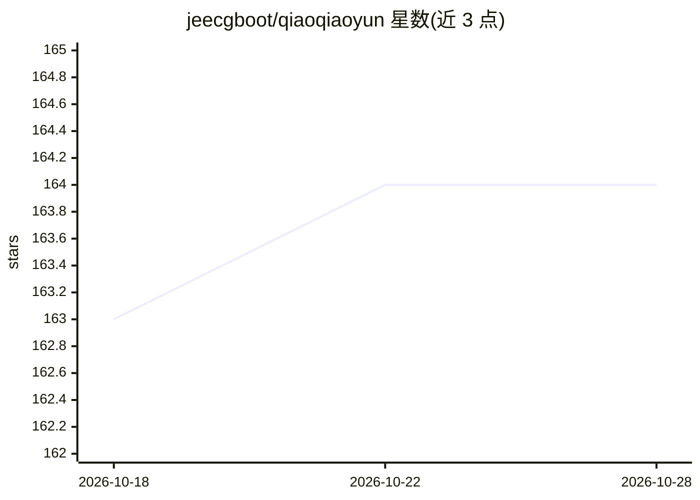

# jeecgboot/qiaoqiaoyun

⭐ 165 · Java · NOASSERTION · 推送 2026-09-17 · [GitHub](https://github.com/jeecgboot/qiaoqiaoyun) · [官网](https://www.qiaoqiaoyun.com) · 组织维护 · 中文 README

**企业零代码应用搭建平台，含AI应用与AI知识库**

面向企业的零代码APaaS平台：拖拽搭建业务系统，提供表单引擎（40+控件）、流程引擎（25种节点）、仪表盘引擎与大屏报表，另集成AI应用平台与AI知识库（接入ChatGPT、DeepSeek等大模型，支持AI建表、智能问答、工作流编排）。开源协议为功能免费、可商用但代码不开放，支持私有化部署。提供一键脚本、Docker Compose与手动部署三种安装方式，手动部署需JDK 8+、MySQL、Redis、MongoDB。官方另开源Claude Code Skills，可用一句话让AI搭建应用、工作表、简流与仪表盘。

## 筛选速览

| 维度 | 判定 | 备注 |
|---|---|---|
| AI 角色 | `ai-enhanced` | 去掉 AI 部分产品仍成立 |
| 许可风险 | `none` | NOASSERTION |
| 部署形态 | `self-host` | docker 或自建部署 |
| 模型依赖 | locked-api |  |
| 硬件要求 | — | 无带数字的原话,不猜 |
| 安装摩擦 | `low` | 无编译、无系统依赖或容器化 |
| 成熟度 | — | 结构信号不足 |

## 能力要点

- 表单/流程/仪表盘三引擎零代码搭建，20+统计图表
- 集成DeepSeek、ChatGPT等大模型，支持AI建表与智能问答
- 私有化部署，一键脚本与Docker Compose安装
- 官方开源Claude Code Skills，一句话AI搭建应用与流程

## 适用场景

- 零代码搭建CRM、进销存、OA等企业业务系统
- 通过AI知识库与智能问答处理企业知识
- 替代纸质/Excel办公做数据采集与自动报表
- 在Claude Code中用一句话生成表单、审批流与看板

## 场景标签

`工作流自动化` `文档问答` · 领域:效率与自动化

## 证据(README 行号)

> L10: 敲敲云是一款 **完全免费** 的零代码应用搭建平台，助力企业快速搭建业务系统和构建AI应用。用户无需编码，即可快速拖拽出复杂业务系统，5分钟可搭建一套CRM系统！她集成了**零代码应用**、**AI应用平台**和**AI知识库*
> L189: - **🤖 AI智能赋能**：集成 ChatGPT、DeepSeek 等主流大模型，支持 AI 建表、智能问答、工作流编排
> L194: - **🏢 私有化部署**：支持本地部署，数据完全自主可控，保障企业数据安全

## 星数曲线

2026-10-18 163 → 2026-10-28 164（+1）

---
*卡片 v1 · prompt 1.4 · 生成 2026-10-22 · 置信度 high · 依据 README sha `842424b6bbca` · [字段定义](../../DATASET.md)*
