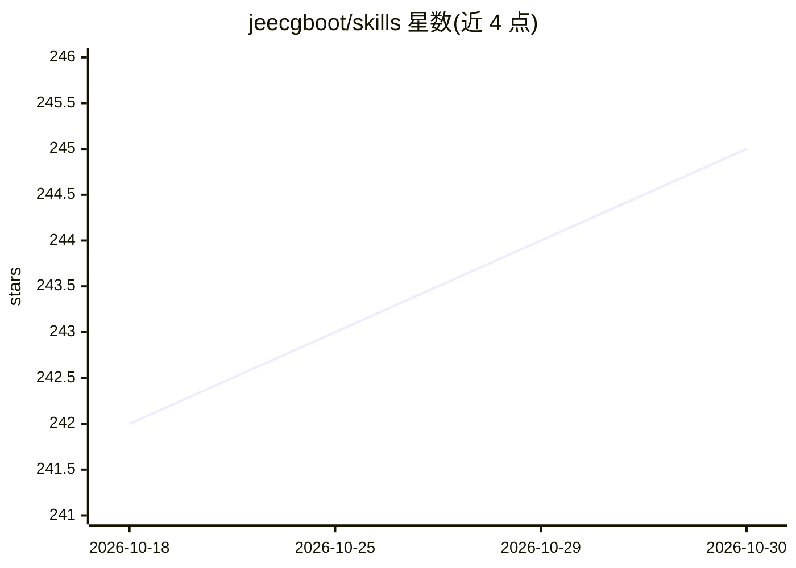

# jeecgboot/skills

⭐ 245 · Python · Apache-2.0 · 推送 2026-10-14 · [GitHub](https://github.com/jeecgboot/skills) · [官网](https://jeecg.com) · 组织维护 · 中文 README

**给 JeecgBoot 开发者的 Claude Code 技能集：一句话生成全套低代码工件**

JeecgBoot 官方维护的 12 个 Claude Code Skills，覆盖 JeecgBoot 低代码平台与 JimuReport 积木报表：在 Claude Code 对话中用自然语言生成 Java+Vue3 CRUD 代码、Online 表单/报表/图表、设计器表单、Flowable BPMN 流程、AIFlow AI 编排、门户配置以及大屏/仪表盘/积木报表，部分技能支持按截图还原。提供一键安装脚本（含写入 DeepSeek v4 作为模型后端、国内镜像加速）或 git clone 到 ~/.claude/skills；前置依赖 Python 3.12+，需修改路径与数据库连接配置并配合 JeecgBoot 3.x 后端 API 使用。

## 筛选速览

| 维度 | 判定 | 备注 |
|---|---|---|
| AI 角色 | `ai-ecosystem` | LLM/agent 周边工具 |
| 许可风险 | `permissive` | Apache-2.0 |
| 部署形态 | `None` |  |
| 模型依赖 | — | README 未给出锁定关系 |
| 硬件要求 | — | 无带数字的原话,不猜 |
| 安装摩擦 | `low` | 无编译、无系统依赖或容器化 |
| 成熟度 | — | 结构信号不足 |

## 能力要点

- 12 个官方 Skills，自然语言触发生成代码/表单/流程/报表/图表/大屏/门户
- jeecg-codegen-new 基于 Freemarker 模板驱动生成，支持单表/树表/主子表多布局
- jeecg-desform 与 jimureport 支持按截图原样还原表单与报表
- 一键安装脚本经国内镜像装齐 Node/Python/Git/Claude Code 并配置 DeepSeek v4 后端

## 适用场景

- 用自然语言生成 JeecgBoot 模块的后端 Java、前端 Vue3 与菜单 SQL
- 在 Claude Code 中创建 Online 表单、数据报表与可视化图表
- 描述审批流程自动生成并部署 Flowable BPMN 2.0 XML
- 一句话搭建数据大屏、仪表盘与积木报表

## 场景标签

`编码 Agent` `代码生成` · 领域:编码与开发

## 证据(README 行号)

> L3: > 在 **Claude Code** 中，用一句话生成 **代码 · 表单 · 流程 · 报表 · 图表 · 大屏 · 仪表盘 · 门户**。
> L90: |1|**jeecg-codegen**|自然语言描述业务需求，自动生成 JeecgBoot 全套 CRUD 代码，支持单表 / 树表 / 主子表|代码生成、创建模块、新增功能、加字段|Java + Vue3 + SQL|
> L59: git clone https://github.com/jeecgboot/skills.git ~/.claude/skills

## 星数曲线

2026-10-18 242 → 2026-10-30 245（+3）

---
*卡片 v1 · prompt 1.4 · 生成 2026-10-22 · 置信度 high · 依据 README sha `28e783b4b031` · [字段定义](../../DATASET.md)*
