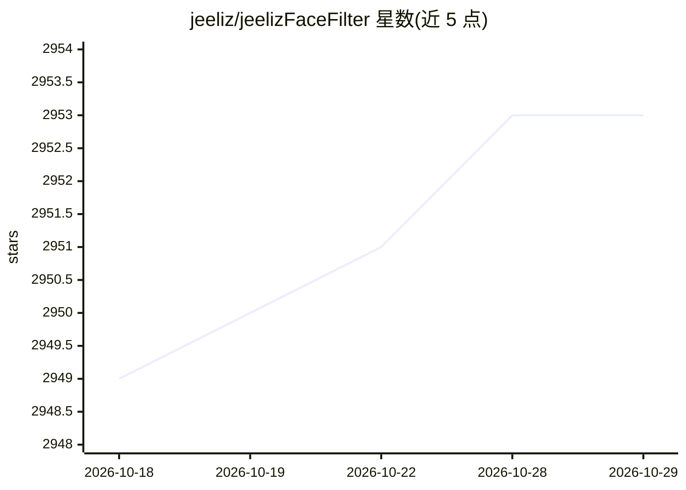

# jeeliz/jeelizFaceFilter

⭐ 2,953 · JavaScript · Apache-2.0 · 推送 2025-11-14 · [GitHub](https://github.com/jeeliz/jeelizFaceFilter) · [官网](https://jeeliz.com) · 组织维护

**浏览器端实时人脸检测追踪 JS 库，用于 AR 面部滤镜**

基于 WebGL 的 JavaScript 人脸检测与追踪库：从 WebRTC 摄像头视频流中实时检测人脸，输出检测状态、位置、缩放与旋转欧拉角等原始数据，供叠加 3D 内容做增强现实面部滤镜。不捆绑任何 3D 引擎，框架无关，但提供 THREE.JS、BABYLON.JS、A-FRAME、CSS3D、Canvas2D 等多种示例与 boilerplate。支持多人脸（最多 8 张）、张嘴检测、深度轴旋转跟踪，移动端可用，神经网络模型以 JSON 文件加载。通过在 HTML 中引入脚本并初始化使用。

## 筛选速览

| 维度 | 判定 | 备注 |
|---|---|---|
| AI 角色 | `ai-native` | 本体是模型或模型工具 |
| 许可风险 | `permissive` | Apache-2.0 |
| 部署形态 | `library` | 以包/库形式分发 |
| 模型依赖 | — | README 未给出锁定关系 |
| 硬件要求 | — | 无带数字的原话,不猜 |
| 安装摩擦 | `medium` | 含编译或系统依赖之一 |
| 成熟度 | — | 结构信号不足 |

## 能力要点

- 实时人脸检测、追踪、旋转与张嘴检测，支持最多 8 张人脸
- 不依赖任何 3D 引擎，输出原始检测数据，框架无关
- 提供 THREE.JS/BABYLON.JS/A-FRAME/CSS3D/Canvas2D 等大量演示与 boilerplate
- 移动端可用，支持 HD 视频

## 适用场景

- 在网页中实现 AR 面部滤镜或虚拟试戴
- 头部姿态控制游戏或鼠标指针
- 人脸替换或人脸变形类 Web 应用
- 视频会议中叠加面部特效

## 场景标签

`人脸识别` · 领域:感知与多模态

## 证据(README 行号)

> L1: # JavaScript/WebGL lightweight and robust face tracking library designed for augmented reality face filters
> L30: * `/neuralNets`: trained neural network models:

## 星数曲线

2026-10-18 2,949 → 2026-10-29 2,953（+4）

---
*卡片 v1 · prompt 1.4 · 生成 2026-10-21 · 置信度 high · 依据 README sha `47122c02084c` · [字段定义](../../DATASET.md)*
