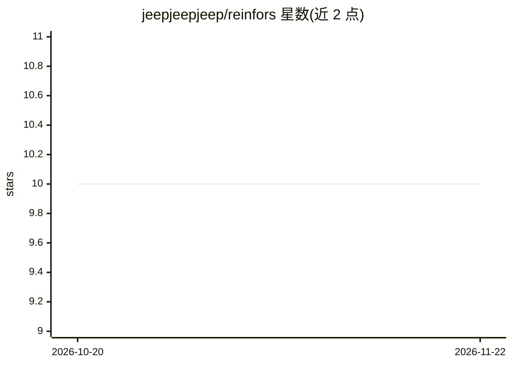

# jeepjeepjeep/reinfors

⭐ 10 · Rust · Apache-2.0 · 推送 2026-09-24 · [GitHub](https://github.com/jeepjeepjeep/reinfors) · 个人维护

**给 Python RL 使用者的高吞吐 Rust 搜索与采样后端**

Rust 编写的强化学习搜索与采样库：游戏动态运行、树搜索、回合编排和批量组装在并行 Rust 后端完成，网络推理通过回调接口交给调用方——用户自带 NumPy 推理回调，框架、优化器、replay、硬件放置与分布式拓扑均由用户掌控。游戏语义覆盖单/多智能体、零和/合作/一般和、轮替/同时决策、完美/不完美信息；算法涵盖策略驱动值学习、搜索引导学习与博弈论求解。通过 pip 安装，Gymnasium/PettingZoo 适配器与 PyTorch 示例为可选扩展，当前处于 pre-1.0 阶段。

## 筛选速览

| 维度 | 判定 | 备注 |
|---|---|---|
| AI 角色 | `ai-native` | 本体是模型或模型工具 |
| 许可风险 | `permissive` | Apache-2.0 |
| 部署形态 | `library` | 以包/库形式分发 |
| 模型依赖 | — | README 未给出锁定关系 |
| 硬件要求 | — | 无带数字的原话,不猜 |
| 安装摩擦 | `low` | 无编译、无系统依赖或容器化 |
| 成熟度 | `idea` | |

## 能力要点

- 并行 Rust 后端承担游戏运行、搜索与批量组装
- 推理回调接收 NumPy 观测并返回模型输出，网络与训练归调用方
- 支持单/多智能体、零和/一般和、完美/不完美信息游戏语义
- 提供 n_threads 并行与 collect_stream 采集训练重叠模式

## 适用场景

- 为 AlphaZero/MCTS 类搜索训练搭建高吞吐环境采样
- 在多智能体博弈（含不完美信息）上运行 CFR/Deep-CFR 求解
- 用自带 PyTorch/JAX 网络接入统一的 RL 采样管线
- 复现或扩展 car_racing 等游戏环境实现

## 场景标签

`强化学习` `多智能体` · 领域:Agent 开发

## 证据(README 行号)

> L6: Reinfors runs game dynamics, search, episode orchestration, and batch assembly in a
> L13: or imperfect information. Algorithms span policy-driven value learning,

## 星数曲线

2026-10-20 10 → 2026-11-22 10（+0）

---
*卡片 v1 · prompt 1.4 · 生成 2026-11-19 · 置信度 high · 依据 README sha `3ba984938a94` · [字段定义](../../DATASET.md)*
