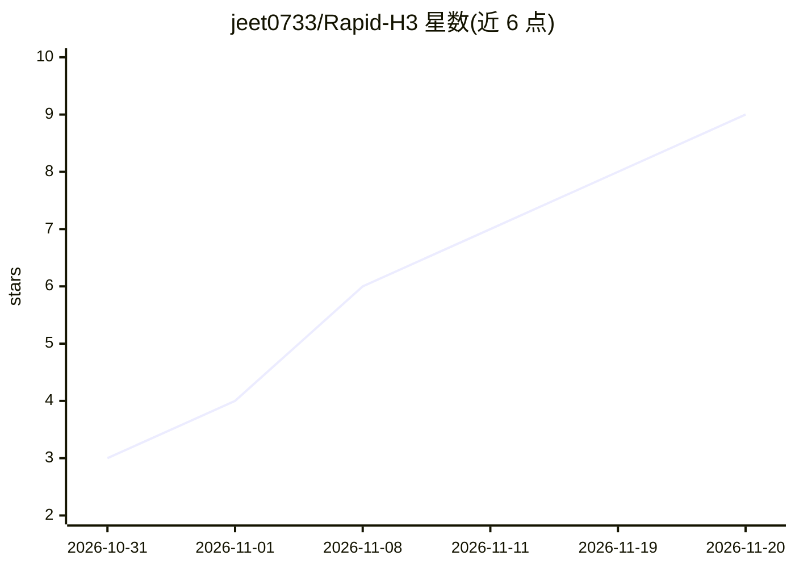

# jeet0733/Rapid-H3

⭐ 9 · Python · Apache-2.0 · 推送 2026-11-10 · [GitHub](https://github.com/jeet0733/Rapid-H3) · 个人维护

**DGX Spark 上加速 MiniMax-H3 视频+音频生成的 ComfyUI 节点包**

一个面向 ComfyUI 的节点包，内置 INT8 sm_121 CUDA kernel 与两个预设（ts_h2 约 114 秒、ts_s6 约 194 秒渲染 141 帧片段），将 MiniMax-H3 文本/图像到视频+立体声的生成在单台 NVIDIA DGX Spark (GB10) 上加速。通过更少更小的步数（6 步 + 0.7× 草稿 + ×2 潜空间上采样）与 INT8 矩阵乘/注意力/文本编码器路径实现。附带质量评测数据表、评分脚本与 Docker 服务器；首次渲染需一次性编译 CUDA kernel，模型权重需自行下载（约 72 GB）。独立社区项目，与 MiniMax、NVIDIA 无隶属关系。

## 筛选速览

| 维度 | 判定 | 备注 |
|---|---|---|
| AI 角色 | `ai-native` | 本体是模型或模型工具 |
| 许可风险 | `permissive` | Apache-2.0 |
| 部署形态 | `None` |  |
| 模型依赖 | — | README 未给出锁定关系 |
| 硬件要求 | — | 无带数字的原话,不猜 |
| 安装摩擦 | `medium` | 含编译或系统依赖之一 |
| 成熟度 | — | 结构信号不足 |

## 能力要点

- INT8 sm_121 CUDA kernel：INT8 矩阵乘、注意力、文本编码器路径与快速视频解码器
- 两个即用预设 ts_h2/ts_s6，针对静态镜头与运镜/特写分别优化
- 附带 ArcFace/SyncNet/UTMOS/DOVER 等质量指标评测结果与复现脚本
- RTX PRO 6000 (sm_120) 亦可运行

## 适用场景

- 在 DGX Spark 本地生成带对白的短视频
- 为 ComfyUI 工作流加载加速后的 MiniMax-H3 节点
- 复现或扩展 INT8 量化 kernel 的视频推理实验

## 场景标签

`视频生成` `模型量化` `模型评测` · 领域:评测与运维

## 证据(README 行号)

> L3: Rapid-H3 makes MiniMax-H3 (text / image → video with stereo audio) render **3–5× faster on a single NVIDIA DGX Spark
> L13: 1. **Faster steps** (the Rapid-H3 kernels, `docs/kernels.md`): INT8 matrix multiplies and attention with our own sm
> L124: Requirements: one NVIDIA DGX Spark (GB10, 128 GB unified memory) with DGX OS and Docker, about 72 GB of disk for t

## 星数曲线

2026-10-31 3 → 2026-11-20 9（+6）

---
*卡片 v1 · prompt 1.4 · 生成 2026-11-20 · 置信度 high · 依据 README sha `b25a6587c113` · [字段定义](../../DATASET.md)*
