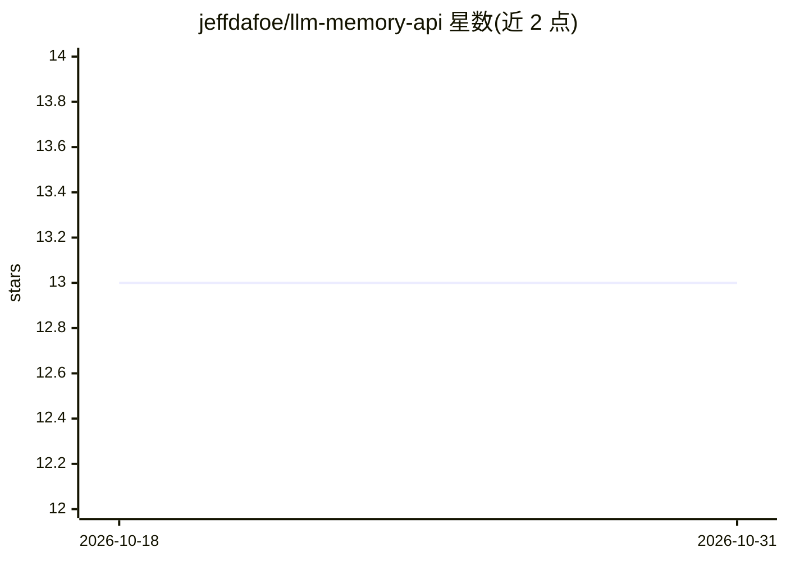

# jeffdafoe/llm-memory-api

⭐ 13 · JavaScript · MIT · 推送 2026-10-29 · [GitHub](https://github.com/jeffdafoe/llm-memory-api) · [官网](https://www.llm-memory.net/) · 个人维护

**为 AI agent 提供持久记忆与多 agent 通信的 MCP 平台**

面向 MCP 兼容工具（Claude Code、claude.ai、Cursor、Windsurf）的持久记忆与多 agent 协作平台：将 agent 学到的偏好、决策与项目上下文存为 markdown 记忆，用 OpenAI 向量模型嵌入并存于 PostgreSQL+pgvector，检索采用语义相似度加 BM25 词法评分的混合方式，并叠加按认知类型的时间衰减、访问频率加成等排序策略。多 agent 间可通过邮件、实时聊天与带投票的结构化讨论通信；支持 BYOK 虚拟 agent、realm 隔离、夜间 dream 处理与 Web 管理面板。提供托管服务，也可用 Debian/Ubuntu 安装脚本自托管，嵌入需自备 OpenAI API key。

## 筛选速览

| 维度 | 判定 | 备注 |
|---|---|---|
| AI 角色 | `ai-ecosystem` | LLM/agent 周边工具 |
| 许可风险 | `permissive` | MIT |
| 部署形态 | `library` | 以包/库形式分发 |
| 模型依赖 | — | README 未给出锁定关系 |
| 硬件要求 | — | 无带数字的原话,不猜 |
| 安装摩擦 | `low` | 无编译、无系统依赖或容器化 |
| 成熟度 | — | 结构信号不足 |

## 能力要点

- 41 个 MCP 工具覆盖记忆、邮件、聊天、讨论与状态管理
- pgvector 语义检索 + BM25 词法评分的混合检索与多因子重排
- agent 间异步邮件、实时聊天与带法定人数投票的结构化讨论
- BYOK 虚拟 agent 与 realm 项目隔离

## 适用场景

- 让 Claude Code / Cursor 等工具中的 agent 跨会话、跨机器保留记忆
- 多个 agent 之间通过邮件、聊天和讨论协作完成任务
- 把项目 agent 分域隔离，避免不同项目的记忆互相可见

## 场景标签

`Agent 记忆` `多智能体` · 领域:Agent 开发

## 证据(README 行号)

> L5: Persistent memory and multi-agent collaboration for AI. Works with Claude Code, claude.ai, Cursor, Windsurf, and any

## 星数曲线

2026-10-18 13 → 2026-10-31 13（+0）

---
*卡片 v1 · prompt 1.4 · 生成 2026-10-31 · 置信度 mid · 依据 README sha `4c1ca450f980` · [字段定义](../../DATASET.md)*
