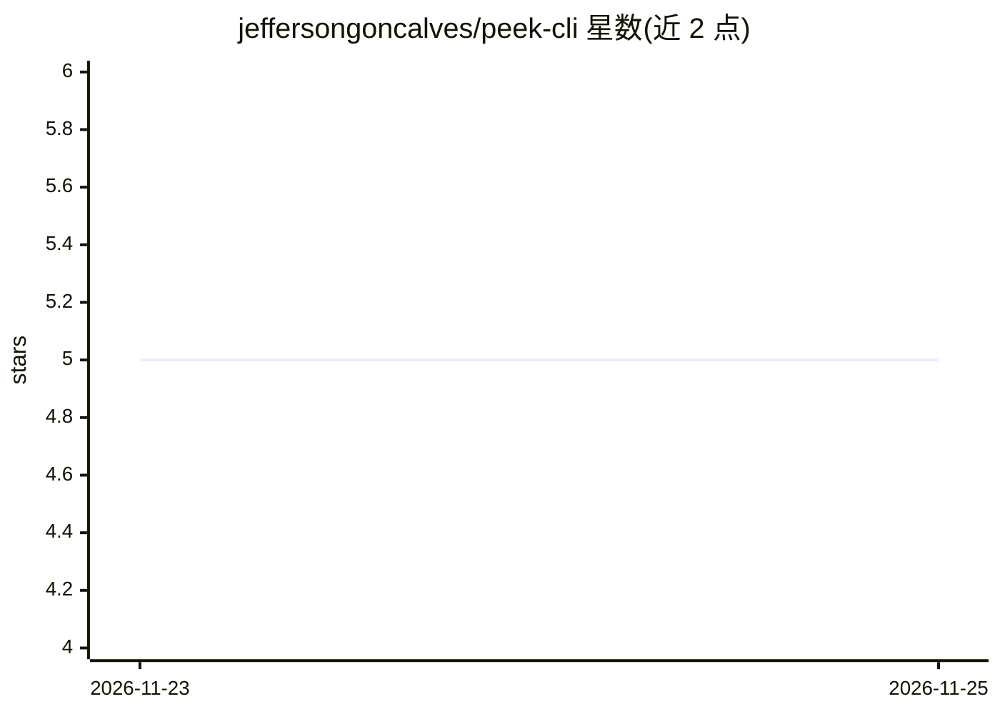

# jeffersongoncalves/peek-cli

⭐ 5 · PHP · MIT · 推送 2026-11-21 · [GitHub](https://github.com/jeffersongoncalves/peek-cli) · 个人维护

**给 LLM 提供远程服务器只读检查的 SSH CLI**

基于 Laravel Zero 的 PHP CLI（PHP ^8.3），通过命名连接配置（profiles）以 SSH 对远程服务器执行固定子命令：ls/tree/cat/tail/grep/ps/df/free/uptime/systemctl status 等。设计目标是让 LLM 排查服务器时不获得 shell：无 exec 命令，参数单引号转义，拒绝以 - 开头的路径，SSH 用 BatchMode=yes。输出支持 table/json/csv，json 用于喂给 LLM 或其他程序。依赖 PATH 上的 ssh 客户端与目标机的 GNU coreutils/findutils/procps。

## 筛选速览

| 维度 | 判定 | 备注 |
|---|---|---|
| AI 角色 | `ai-enhanced` | 去掉 AI 部分产品仍成立 |
| 许可风险 | `permissive` | MIT |
| 部署形态 | `None` |  |
| 模型依赖 | — | README 未给出锁定关系 |
| 硬件要求 | — | 无带数字的原话,不猜 |
| 安装摩擦 | `low` | 无编译、无系统依赖或容器化 |
| 成熟度 | — | 结构信号不足 |

## 能力要点

- 固定子命令+单引号转义+无 exec 的只读安全机制
- 命名连接配置，可复用 ~/.ssh/config 的别名与密钥
- table/json/csv 输出格式，json 便于管道给 LLM
- 提供 composer 全局安装与独立 PHAR，支持 self-update

## 适用场景

- 让 AI agent 只读检查生产服务器的日志、进程与磁盘
- 禁止 LLM 获得交互式 shell 的场景下做远程巡检
- 脚本化采集多台服务器状态并输出 json

## 场景标签

 · 领域:开发运维/服务器管理

## 证据(README 行号)

> L10: Read-only inspection of remote servers over SSH through named profiles, with
> L11: table/json/csv output. Built to pair with an LLM investigating a server —
> L95: `--format=text|json|csv` (default `text`). `json` is the format to reach for

## 星数曲线

2026-11-23 5 → 2026-11-25 5（+0）

---
*卡片 v1 · prompt 1.4 · 生成 2026-11-23 · 置信度 high · 依据 README sha `704d5491f759` · [字段定义](../../DATASET.md)*
