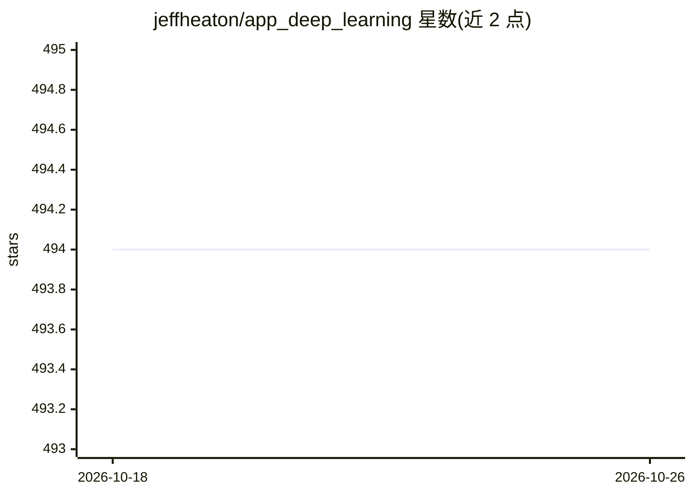

# jeffheaton/app_deep_learning

⭐ 494 · Jupyter Notebook · Apache-2.0 · 推送 2026-09-01 · [GitHub](https://github.com/jeffheaton/app_deep_learning) · [官网](https://sites.wustl.edu/jeffheaton/t81-558/) · 组织维护

**华盛顿大学深度神经网络应用课程仓库（PyTorch）**

华盛顿大学圣路易斯分校 T81-558 课程《深度神经网络应用》的教学仓库，由讲师 Jeff Heaton 维护。课程以 Python 与 PyTorch 为工具，按 13 个模块组织，内容覆盖神经网络基础、CNN、时间序列（LSTM/Transformer）、Kaggle 数据集、生成式 AI 基础（Transformers/Hugging Face/扩散模型）、人脸处理、模型调试与可解释性、自编码器与强化学习等，含编程作业与 Kaggle 竞赛；README 提供教学大纲表与数据集下载链接。

## 筛选速览

| 维度 | 判定 | 备注 |
|---|---|---|
| AI 角色 | `ai-knowledge` | 知识聚合/清单类 |
| 许可风险 | `permissive` | Apache-2.0 |
| 部署形态 | `None` |  |
| 模型依赖 | — | README 未给出锁定关系 |
| 硬件要求 | — | 无带数字的原话,不猜 |
| 安装摩擦 | `low` | 无编译、无系统依赖或容器化 |
| 成熟度 | — | 结构信号不足 |

## 能力要点

- 13 个模块覆盖 CNN、时间序列、生成式 AI、可解释性等主题
- 以 Python 与 PyTorch 为实现工具，含编程作业与 Kaggle 竞赛
- 提供教学大纲与数据集下载入口

## 适用场景

- 系统学习 PyTorch 深度学习应用的课程材料
- 查阅各深度学习主题的模块化讲义结构与作业安排
- 配合课程完成 Kaggle 竞赛实践

## 场景标签

`教程课程` · 领域:学习与行业

## 证据(README 行号)

> L12: Deep learning is a group of exciting new technologies for neural networks. Through a combination of advanced traini
> L27: |Module 1 **Meet on 08/25/2026**|**Module 1: Introduction to Neural Networks** 1.1 Overview 1.2 AI and Neural Netwo

## 星数曲线

2026-10-18 494 → 2026-10-26 494（+0）

---
*卡片 v1 · prompt 1.4 · 生成 2026-10-21 · 置信度 high · 依据 README sha `d697b6a99263` · [字段定义](../../DATASET.md)*
