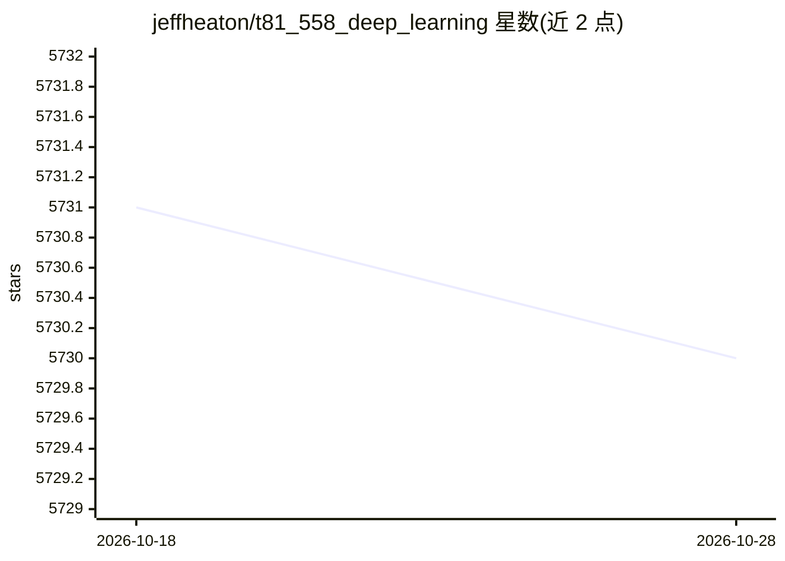

# jeffheaton/t81_558_deep_learning

⭐ 5,731 · Jupyter Notebook · NOASSERTION · 推送 2026-04-25 · [GitHub](https://github.com/jeffheaton/t81_558_deep_learning) · [官网](https://sites.wustl.edu/jeffheaton/t81-558/) · 组织维护

**圣路易斯华盛顿大学深度学习课程教材仓库（Keras/TF 版）**

T81-558《深度神经网络应用》课程的完整教学内容仓库，由 Jeff Heaton 讲授，覆盖 Python 预备、Pandas、TensorFlow/Keras 建模、CNN、GAN（含 StyleGAN3）、迁移学习、时间序列/LSTM、Transformers、Hugging Face、强化学习与部署监控共 13 个模块，含课程目标、教学大纲、作业时间表与配套教科书（ISBN 9798416344269）及数据集下载入口。README 开头说明：本校在读学生应参考现行的 PyTorch 版本，本仓库为此前的 Keras/TensorFlow 版本。

## 筛选速览

| 维度 | 判定 | 备注 |
|---|---|---|
| AI 角色 | `ai-knowledge` | 知识聚合/清单类 |
| 许可风险 | `none` | NOASSERTION |
| 部署形态 | `None` |  |
| 模型依赖 | — | README 未给出锁定关系 |
| 硬件要求 | — | 无带数字的原话,不猜 |
| 安装摩擦 | `low` | 无编译、无系统依赖或容器化 |
| 成熟度 | — | 结构信号不足 |

## 能力要点

- 13 个模块覆盖 CNN/GAN/LSTM/Transformers/强化学习等主题与作业安排
- 配套教科书《Applications of Deep Neural Networks with Keras》
- 涉及 Hugging Face、Kaggle、TPU 部署等实践内容
- 提供课程数据集下载入口

## 适用场景

- 按模块自学 Keras/TensorFlow 深度学习课程内容
- 查找深度学习课程的作业与项目结构作参考
- 引用课程/教材内容（提供 BibTeX 条目）

## 场景标签

`教程课程` · 领域:学习与行业

## 证据(README 行号)

> L3: Current students of this course at Washington University should refer to the PyTorch version of this course, which i
> L17: Deep learning is a group of exciting new technologies for neural networks. Through a combination of advanced traini
> L38: # Syllabus

## 星数曲线

2026-10-18 5,731 → 2026-10-28 5,730（-1）

---
*卡片 v1 · prompt 1.4 · 生成 2026-10-20 · 置信度 high · 依据 README sha `8f787fddbd9c` · [字段定义](../../DATASET.md)*
