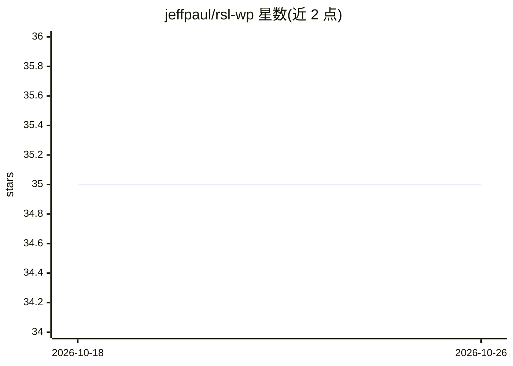

# jeffpaul/rsl-wp

⭐ 35 · PHP · 推送 2026-10-23 · [GitHub](https://github.com/jeffpaul/rsl-wp) · 个人维护

**WordPress 插件：为站点内容定义机器可读的 RSL 许可条款**

实现 Really Simple Licensing (RSL) 1.0 标准的 WordPress 插件，面向站点所有者：通过可视化 License Builder 创建许可条款，将 XML 许可注入 HTML head、HTTP Link 头、robots.txt、RSS 与媒体文件元数据，使 AI 公司与爬虫能机器读取内容使用条款。支持全站与单篇内容许可、按用途/用户类型/地域的权限控制，付费许可经 WooCommerce 收款并用 OAuth 2.0 Client Credentials 与 JWT 令牌做认证、限流与撤销。当前为 v0.0.5-alpha，供测试与开发用途。

## 筛选速览

| 维度 | 判定 | 备注 |
|---|---|---|
| AI 角色 | `ai-ecosystem` | LLM/agent 周边工具 |
| 许可风险 | `none` | — |
| 部署形态 | `desktop` | 安装包/桌面程序 |
| 模型依赖 | — | README 未给出锁定关系 |
| 硬件要求 | — | 无带数字的原话,不猜 |
| 安装摩擦 | `low` | 无编译、无系统依赖或容器化 |
| 成熟度 | `idea` | |

## 能力要点

- RSL 1.0 规范完整实现，全站与单篇内容两级许可
- 多种注入通道：HTML head、HTTP Link 头、robots.txt、RSS、媒体元数据
- 付费许可经 WooCommerce 处理，OAuth 2.0 Client Credentials + JWT 令牌含撤销与限流
- 提供 REST API、Shortcode 与模板函数

## 适用场景

- 为我的 WordPress 站点声明 AI 训练/使用的内容许可条款
- 通过 WooCommerce 向 AI 公司出售内容使用许可
- 按用途（train-ai、ai-summarize 等）与地域细化授权范围

## 场景标签

 · 领域:内容许可/Web 基础设施

## 证据(README 行号)

> L9: Complete Really Simple Licensing (RSL) support for WordPress sites. Define machine-readable licensing terms for your
> L31: **Really Simple Licensing (RSL)** is an open standard for machine-readable content licensing, making it easy for AI
> L53: - **AI companies** to automatically discover licensing terms

## 星数曲线

2026-10-18 35 → 2026-10-26 35（+0）

---
*卡片 v1 · prompt 1.4 · 生成 2026-10-25 · 置信度 high · 依据 README sha `94c583f791d3` · [字段定义](../../DATASET.md)*
