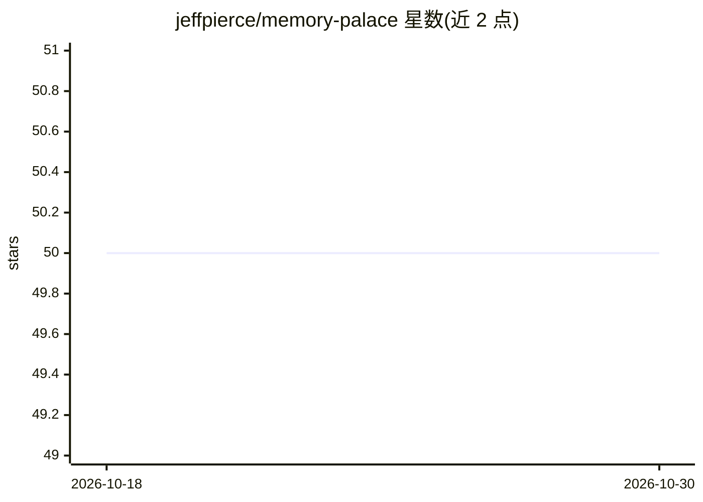

# jeffpierce/memory-palace

⭐ 50 · Python · MIT · 推送 2026-02-15 · [GitHub](https://github.com/jeffpierce/memory-palace) · [官网](https://github.com/sponsors/jeffpierce/) · 个人维护

**给 AI agent 的持久语义记忆层：MCP 记忆存取与知识图谱**

面向 MCP 兼容 AI 客户端的持久记忆系统：通过 13 个 MCP 工具实现记忆的存储、语义检索、归档与遗忘，检索按语义相似度、访问频率与图谱中心性加权排序。支持类型化加权边的知识图谱与自动链接，可从会话记录提取记忆、将源码索引为散文描述供自然语言代码搜索，并提供多 AI 实例间的发布/订阅消息。嵌入、抽取与合成均通过 Ollama 本地运行，后端支持 SQLite 或 PostgreSQL+pgvector，另有 OpenClaw 原生插件。

## 筛选速览

| 维度 | 判定 | 备注 |
|---|---|---|
| AI 角色 | `ai-ecosystem` | LLM/agent 周边工具 |
| 许可风险 | `permissive` | MIT |
| 部署形态 | `None` |  |
| 模型依赖 | local-ok | 支持本地模型 |
| 硬件要求 | — | 无带数字的原话,不猜 |
| 安装摩擦 | `low` | 无编译、无系统依赖或容器化 |
| 成熟度 | — | 结构信号不足 |

## 能力要点

- 13 个 MCP 工具覆盖记忆存取、图谱、消息、代码索引与维护
- 检索按语义相似度+访问频率+图谱中心性加权排序
- 所有嵌入与抽取通过 Ollama 本地运行，支持 SQLite/PostgreSQL+pgvector
- 多实例间发布/订阅消息与 OpenClaw 原生插件

## 适用场景

- 让 Claude Desktop 等 MCP 客户端跨会话记住决策与项目上下文
- 把不同模型/实例的积累记忆集中在一处共享
- 用自然语言搜索本地代码库（基于散文描述的代码索引）

## 场景标签

`Agent 记忆` `知识图谱` · 领域:Agent 开发

## 证据(README 行号)

> L5: Persistent semantic memory for AI agents. Store facts, decisions, insights, and context across conversations. Search
> L63: - **MCP Integration** — Works natively with any MCP-compatible client (Claude Desktop, Claude Code, etc.)

## 星数曲线

2026-10-18 50 → 2026-10-30 50（+0）

---
*卡片 v1 · prompt 1.4 · 生成 2026-10-24 · 置信度 high · 依据 README sha `f198be7de001` · [字段定义](../../DATASET.md)*
