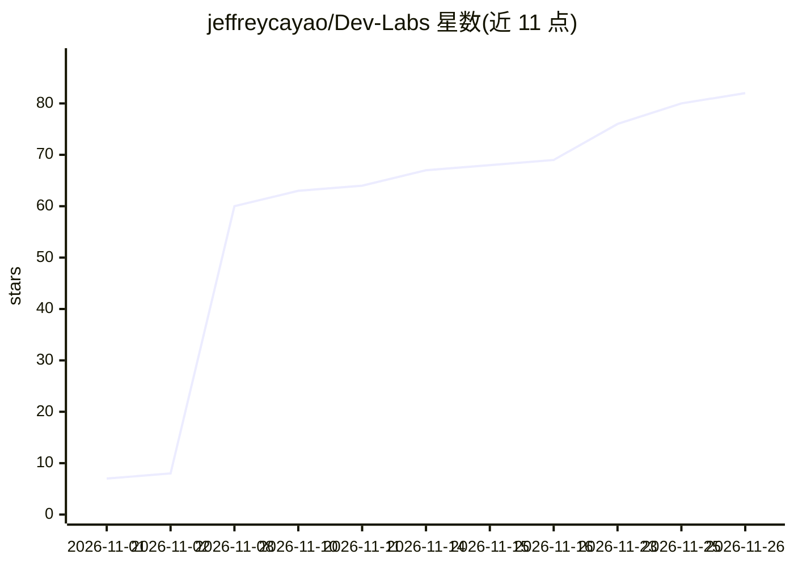

# jeffreycayao/Dev-Labs

⭐ 82 · TypeScript · MIT · 推送 2026-11-25 · [GitHub](https://github.com/jeffreycayao/Dev-Labs) · [官网](http://devlabs.atmt.dev/) · 个人维护

**桌面多 agent 编排应用：把终端编码 CLI 组成协作团队**

Electron 桌面应用，将 Claude Code、Codex、Gemini CLI、Grok、Kimi、Qwen、OpenCode、Cursor 等终端编码 CLI 包装为多 agent 团队：每个 agent 以真实进程运行在伪终端中，以 3D 办公室形象呈现，拥有 Markdown 长期记忆、收件箱与工位；编排者 Ramon 负责规划、路由与裁决，仅关键事项升级给人。通过本地 git 仓库形式的 hive 协调，提供 token 预算、熔断器、交付物管理等。需至少一个 agent CLI 登录后使用，密钥经 OS 加密与本地代理。macOS/Windows/Linux 提供安装包。

## 筛选速览

| 维度 | 判定 | 备注 |
|---|---|---|
| AI 角色 | `ai-ecosystem` | LLM/agent 周边工具 |
| 许可风险 | `permissive` | MIT |
| 部署形态 | `desktop` | 安装包/桌面程序 |
| 模型依赖 | local-ok | 支持本地模型 |
| 硬件要求 | — | 无带数字的原话,不猜 |
| 安装摩擦 | `low` | 无编译、无系统依赖或容器化 |
| 成熟度 | — | 结构信号不足 |

## 能力要点

- 将 12 种终端 agent CLI 包装为真实进程并统一编排
- 编排者 Ramon 负责规划、路由、裁决与升级
- hive：本地 git 仓库形式的共享文件、邮箱与事件日志
- token 预算、熔断器、人工审批等控制机制

## 适用场景

- 把已订阅的多个编码 CLI 组成团队协作完成任务
- 用自然语言向一个管理者分派多 agent 工作
- 多楼层管理多个仓库/文件夹的并行 agent 任务

## 场景标签

`多智能体` `编码 Agent` · 领域:Agent 开发

## 证据(README 行号)

> L84: DevLabs is a desktop app that wraps **real terminal-agent CLIs** as fully capable agents,
> L7: **Free, open source and local-first.** A multi-agent harness that works with the AI

## 星数曲线

2026-11-01 7 → 2026-11-26 82（+75）

---
*卡片 v1 · prompt 1.4 · 生成 2026-11-18 · 置信度 high · 依据 README sha `e6a4f6a9e359` · [字段定义](../../DATASET.md)*
