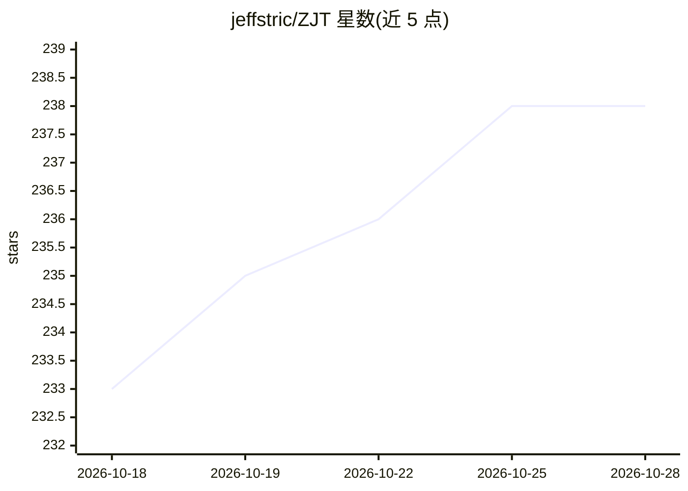

# jeffstric/ZJT

⭐ 238 · Python · NOASSERTION · 推送 2026-10-22 · [GitHub](https://github.com/jeffstric/ZJT) · [官网](http://ailive.perseids.cn) · 个人维护 · 中文 README

**面向零基础创作者的 AI 短剧一站式制作平台**

智剧通（ZJT）是多智能体协作的短剧制作平台：PM Agent 与 8 个专家智能体（编剧、角色、场景、情节分析、合规审核等）分工，覆盖剧本创作、无限画布分镜设计、参考图生成到视频合成的流程。支持 10+ LLM（Claude、Ollama、通义千问、豆包等）与多家视频生成 API 切换，提供用户级独立算力账户、管理员热更新与微信支付集成，面向教培、团队协作和企业场景。提供 Windows/macOS 安装包、Linux 源码部署与 Docker；采用修改版 Apache 2.0 协议，禁止运营多空间服务与移除品牌信息。

## 筛选速览

| 维度 | 判定 | 备注 |
|---|---|---|
| AI 角色 | `ai-native` | 本体是模型或模型工具 |
| 许可风险 | `none` | NOASSERTION |
| 部署形态 | `desktop` | 安装包/桌面程序 |
| 模型依赖 | local-ok | 支持本地模型 |
| 硬件要求 | — | 无带数字的原话,不猜 |
| 安装摩擦 | `low` | 无编译、无系统依赖或容器化 |
| 成熟度 | — | 结构信号不足 |

## 能力要点

- PM Agent + 8 个专家智能体的多智能体协作架构，含 ask_user 用户交互工具
- 剧本→分镜→视频合成全流程，支持 10+ LLM 与多视频生成 API 灵活切换
- 用户级独立算力账户、管理员热更新配置、微信支付集成
- 浏览器端多人实时协作（SSE 同步），支持局域网与公网部署

## 适用场景

- 零基础创作者快速生成短剧的剧本、分镜与成片
- 教培机构为学员分配独立算力账户开展短视频创作教学
- 内容团队多人实时协同编辑剧本与分镜

## 场景标签

`多智能体` `视频生成` `AI 写作` · 领域:Agent 开发

## 证据(README 行号)

> L3: > 用 AI 智能体协同，让零基础创作者快速生成专业级短剧
> L12: |🤖 AI 智能体协同|🎨 专业分镜设计|📹 一键生成短剧|🌍 多模型支持|
> L14: |8个专家智能体分工协作，ask_user 工具与用户交互|无限画布 + 多宫格分镜设计|自动剧本→分镜→视频生成|支持 10+ LLM，灵活切换|
> L130: 智剧通 采用多智能体协作架构，由 **PM Agent（项目经理）** 和 **8 个 Expert Agents（专家团队）** 组成：

## 星数曲线

2026-10-18 233 → 2026-10-28 238（+5）

---
*卡片 v1 · prompt 1.4 · 生成 2026-10-22 · 置信度 high · 依据 README sha `b05677c97802` · [字段定义](../../DATASET.md)*
