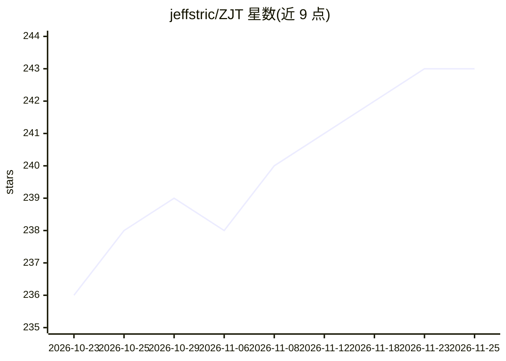

# jeffstric/ZJT

⭐ 243 · Python · NOASSERTION · 推送 2026-11-18 · [GitHub](https://github.com/jeffstric/ZJT) · [官网](http://ailive.perseids.cn) · 个人维护 · 中文 README

**面向营销团队与零基础创作者的 AI 短剧/营销视频制作平台**

多智能体协作平台，由 PM Agent 与 8 个专家智能体分工完成剧本编写、角色/场景设定、分镜生成与视频合成，流程覆盖 brief 输入到成片输出。内置 50+ MCP 工具、ask_user 用户交互机制、世界系统与角色形象锁定维护品牌 IP 一致性，支持数字人口播、音色克隆、视频克隆与批量 A/B 变体生成。提供 Windows/macOS 安装包、Docker 与源码部署，采用修改版 Apache 2.0，另设商业企业版（图文转视频、视频克隆等能力）；用户级算力账户与微信支付计费面向教培与团队成本管理。

## 筛选速览

| 维度 | 判定 | 备注 |
|---|---|---|
| AI 角色 | `ai-native` | 本体是模型或模型工具 |
| 许可风险 | `none` | NOASSERTION |
| 部署形态 | `desktop` | 安装包/桌面程序 |
| 模型依赖 | local-ok | 支持本地模型 |
| 硬件要求 | — | 无带数字的原话,不猜 |
| 安装摩擦 | `low` | 无编译、无系统依赖或容器化 |
| 成熟度 | — | 结构信号不足 |

## 能力要点

- PM Agent + 8 专家智能体协作，ask_user 工具主动与用户对齐创意
- 世界系统/角色形象锁定保证跨作品 IP 一致性
- 内置 50+ MCP 工具，营销工作流以 SOP 形态插件化接入
- 用户级独立算力账户、管理员热更新与微信支付计费

## 适用场景

- 从营销 brief 一键产出带货脚本、分镜与口播视频
- 企业品牌 IP 短剧连载与角色形象统一维护
- 教培机构为学员分配独立算力额度开展创作教学
- 爆款视频换品复刻并批量生成 A/B 投放变体

## 场景标签

`视频生成` `AI 写作` · 领域:内容生成

## 证据(README 行号)

> L3: > 用 AI 智能体协同，让营销团队与零基础创作者快速生成专业级营销内容（品牌视频、营销短片、短剧等）
> L225: 智剧通 采用多智能体协作架构，由 **PM Agent（项目经理）** 和 **8 个 Expert Agents（专家团队）** 组成：
> L101: - **开源 + 商业双版本**：开源版可自由部署、允许商业使用（修改版 Apache 2.0）；商业版（企业版）解锁图文转视频、视频克隆等企业能力

## 星数曲线

2026-10-23 236 → 2026-11-25 243（+7）

---
*卡片 v1 · prompt 1.4 · 生成 2026-11-25 · 置信度 high · 依据 README sha `3729c3843226` · [字段定义](../../DATASET.md)*
