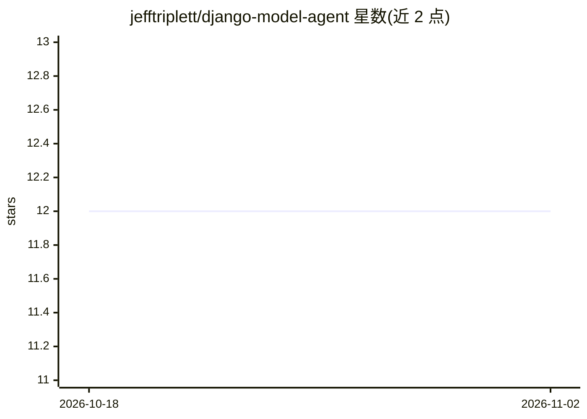

# jefftriplett/django-model-agent

⭐ 12 · Python · NOASSERTION · 推送 2026-11-01 · [GitHub](https://github.com/jefftriplett/django-model-agent) · [官网](https://django-model-agent.readthedocs.io) · 个人维护

**将 Django 模型声明式绑定到 Pydantic AI Agent 的抽象库**

面向 Django 开发者的 Python 库：参照 Django Ninja 的 ModelSchema 风格，提供 ModelAgent/ModelTool 抽象层，声明式定义 agent 可访问的模型字段、字段集、system prompt、instructions（支持 Django 模板）与工具注册，并从 Django 模型自动生成 Pydantic schema。执行 prompt 需自行子类化 ModelAgent 并实现 build_agent() 接入 pydantic-ai。项目自述为实验性、API 会变化，尚未发布到 PyPI，需从 GitHub 安装；开发要求 Python 3.13+；许可证为 PolyForm Noncommercial。

## 筛选速览

| 维度 | 判定 | 备注 |
|---|---|---|
| AI 角色 | `ai-ecosystem` | LLM/agent 周边工具 |
| 许可风险 | `none` | NOASSERTION |
| 部署形态 | `library` | 以包/库形式分发 |
| 模型依赖 | — | README 未给出锁定关系 |
| 硬件要求 | — | 无带数字的原话,不猜 |
| 安装摩擦 | `medium` | 含编译或系统依赖之一 |
| 成熟度 | `idea` | |

## 能力要点

- 声明式定义 agent 可访问的 Django 模型字段与排除字段
- 字段集（field sets）支持按角色暴露字段
- 从 Django 模型自动生成 Pydantic schema
- 通过类属性或装饰器注册 system prompt/instructions/tool，支持 Django 模板

## 适用场景

- 为已有 Django 模型快速搭建可操作该模型的 AI agent
- 按角色控制 agent 可见的模型字段范围
- 结合 pydantic-ai 构建读写型或只读型模型工具

## 场景标签

`Agent 框架` · 领域:Agent 开发

## 证据(README 行号)

> L5: A Django Ninja-style abstraction for binding Django models to Pydantic AI Agents.
> L39: Today, the stable part of the package is the Django model/schema/tool abstraction layer. To execute prompts, subcla

## 星数曲线

2026-10-18 12 → 2026-11-02 12（+0）

---
*卡片 v1 · prompt 1.4 · 生成 2026-11-01 · 置信度 mid · 依据 README sha `a24b9847a841` · [字段定义](../../DATASET.md)*
